# DISEÑO COMPLETO DE BASE DE DATOS
## Sistema de Gestión de Activos TI — CIPRIJAL
**Versión:** 1.0 — Diseño para revisión y aprobación  
**Fecha:** 2026-06-27  
**Sprint:** 1.4 — Diseño completo de la base de datos  
**Estado:** BORRADOR — pendiente de aprobación antes de implementar

> Este documento es una **propuesta de diseño**. No implica modificación de ningún archivo del proyecto. La implementación en `prisma/schema.prisma` ocurre en el sprint siguiente, una vez aprobado este diseño.

---

## 1. OBJETIVOS DEL DISEÑO

1. **Completitud funcional:** Cubrir todos los módulos de v1.0: inventario, asignaciones, gastos adicionales, incidencias, mantenimientos, documentos, alertas, auditoría.
2. **Integridad de datos:** Constraints en BD que imposibiliten estados inválidos (no solo validaciones en código).
3. **Trazabilidad total:** Historial completo e inmutable de cada activo desde registro hasta baja.
4. **Extensibilidad prudente:** Diseño que soporte los módulos del ROADMAP sin reestructuración destructiva.
5. **Rendimiento adecuado:** Índices correctos para las consultas frecuentes del sistema.
6. **Seguridad por diseño:** Campos sensibles identificados y estrategia de cifrado definida antes de implementar.

---

## 2. PRINCIPIOS APLICADOS

| # | Principio | Decisión |
|---|---|---|
| P-01 | **UUID v4 como PK** | Todos los `@id @default(uuid())`. Nunca autoincrement. Evita enumeración de IDs en la API. |
| P-02 | **Prisma como fuente de verdad** | `schema.prisma` define todos los modelos. Migraciones con `prisma migrate`. |
| P-03 | **Soft delete selectivo** | Solo en entidades donde el borrado lógico aporta valor real. Ver análisis en Sección 8. |
| P-04 | **Timestamps automáticos** | `createdAt` y `updatedAt` en todas las tablas. `updatedAt` con `@updatedAt`. |
| P-05 | **Auditoría centralizada** | Tabla `audit_logs` única, de solo inserción. Sin audit trails por módulo. |
| P-06 | **JSONB para specs variables** | Campo `specs Json?` en `Asset` para especificaciones técnicas variables por tipo de hardware. |
| P-07 | **Fechas en UTC** | `DateTime` en Prisma → `TIMESTAMPTZ` en PostgreSQL. Conversión a hora local en la aplicación. |
| P-08 | **snake_case en BD** | Columnas y tablas en snake_case mediante `@map()` y `@@map()`. Prisma expone camelCase. |
| P-09 | **Montos únicamente en MXN** | Todos los costos se almacenan en pesos mexicanos (MXN). Sin conversión de divisas ni campos USD. |
| P-10 | **Campos sensibles cifrados** | `biosPassword` y `devicePassword` se cifran en capa de aplicación (AES-256-GCM) antes de persistir. |
| P-11 | **Inmutabilidad del histórico** | Asignaciones, gastos, incidencias y mantenimientos no tienen soft delete — son registros históricos inmutables. |

---

## 3. ENTIDADES Y ATRIBUTOS

### 3.1 `users` — Usuarios del sistema

**Propósito:** Tabla unificada de credenciales + datos del colaborador. No existe tabla separada de empleados.

**Cambio respecto a MODELO_BASE_DATOS.md v2.0:** El campo `name String` se divide en `firstName String` + `lastName String` para soportar el formato formal de nombre en actas (ver justificación en Sección 9.1), búsqueda por apellido y ordenamiento correcto en reportes.

| Campo | Tipo | Nulable | Notas |
|---|---|---|---|
| id | String (UUID) | NO | PK |
| firstName | String | NO | Nombre(s) del colaborador |
| lastName | String | NO | Apellido(s) del colaborador |
| email | String | NO | UNIQUE — Email corporativo |
| passwordHash | String | NO | Hash bcrypt |
| role | Role (enum) | NO | `admin_ti` \| `usuario_final` |
| position | String? | SÍ | Puesto o cargo |
| phone | String? | SÍ | Celular de contacto (no teléfono fijo) |
| modality | Modality? (enum) | SÍ | `presencial` \| `remoto` |
| locationId | String? (FK) | SÍ | → Location (localidad donde trabaja) |
| isActive | Boolean | NO | `default(true)` |
| mustChangePassword | Boolean | NO | `default(false)` |
| lastLoginAt | DateTime? | SÍ | Último acceso registrado |
| failedLoginAttempts | Int | NO | `default(0)` |
| lockedUntil | DateTime? | SÍ | Bloqueo temporal por intentos fallidos |
| createdAt | DateTime | NO | `default(now())` |
| updatedAt | DateTime | NO | `@updatedAt` |
| deletedAt | DateTime? | SÍ | Soft delete (ver Sección 8) |

**Enums:**
```
Role:     admin_ti | usuario_final
Modality: presencial | remoto
```

**Índices:**
- `@@index([role])`
- `@@index([locationId])`
- `@@index([isActive])`

---

### 3.2 `locations` — Localidades operativas

**Propósito:** Catálogo plano de sedes donde opera CIPRIJAL (ej: "Yucatán", "Tabasco", "Guadalajara"). Sin jerarquía, sin edificios.

**Soft delete:** SÍ. Una localidad puede tener activos y usuarios históricos. Se desactiva con `isActive = false` para nuevas asignaciones; `deletedAt` se usa si se necesita borrado lógico sin perder las referencias históricas.

| Campo | Tipo | Nulable | Notas |
|---|---|---|---|
| id | String (UUID) | NO | PK |
| name | String | NO | Nombre de la localidad |
| description | String? | SÍ | Notas adicionales |
| isActive | Boolean | NO | `default(true)` |
| createdAt | DateTime | NO | `default(now())` |
| updatedAt | DateTime | NO | `@updatedAt` |
| deletedAt | DateTime? | SÍ | Soft delete |

**Índices:** `@@index([isActive])`

---

### 3.3 `assets` — Activos de hardware *(TABLA CENTRAL)*

**Propósito:** Registro maestro de todos los activos TI. El número de serie es `NOT NULL` por regla de negocio innegociable (BR-INV-02).

**Cambios respecto a MODELO_BASE_DATOS.md v2.0:**
- Añadido: `biosPassword String?` — contraseña del BIOS (cifrada en aplicación)
- Añadido: `devicePassword String?` — contraseña del SO/dispositivo (cifrada en aplicación)
- Añadido: `usefulLifeYears Int?` — vida útil estimada en años
- Renombrado: `purchasePriceLocal` → `purchasePrice` (campo único en MXN, sin contraparte USD)
- Expandido: `AssetStatus` enum incluye ahora `stolen` y `lost` (listados en ESPECIFICACION_FUNCIONAL.md sección 4.1 pero ausentes en v2.0 del modelo)

| Campo | Tipo | Nulable | Notas |
|---|---|---|---|
| id | String (UUID) | NO | PK |
| internalCode | String | NO | UNIQUE — Formato: HW-2026-0001 |
| name | String | NO | Nombre descriptivo del activo |
| assetType | AssetType (enum) | NO | Tipo de hardware |
| serialNumber | String | NO | UNIQUE — **Obligatorio, NOT NULL** |
| brand | String? | SÍ | Marca / Fabricante |
| model | String? | SÍ | Modelo exacto del fabricante |
| status | AssetStatus (enum) | NO | Estado actual, `default(registered)` |
| condition | AssetCondition (enum) | NO | Condición física actual |
| purchaseDate | DateTime? | SÍ | Fecha de compra |
| purchasePrice | Decimal? | SÍ | Precio de compra en MXN |
| supplierName | String? | SÍ | Proveedor (texto libre en v1.0) |
| invoiceNumber | String? | SÍ | Número de factura |
| warrantyExpiryDate | DateTime? | SÍ | Fecha de vencimiento de garantía |
| usefulLifeYears | Int? | SÍ | Vida útil estimada en años |
| biosPassword | String? | SÍ | Contraseña del BIOS — **CIFRADA con AES-256-GCM** |
| devicePassword | String? | SÍ | Contraseña del SO/dispositivo — **CIFRADA con AES-256-GCM** |
| locationId | String? (FK) | SÍ | → Location |
| notes | String? | SÍ | Observaciones libres |
| specs | Json? | SÍ | Especificaciones técnicas por tipo (JSONB) |
| qrCode | String? | SÍ | UNIQUE — Código del QR imprimible |
| imagePath | String? | SÍ | Ruta de imagen del activo |
| createdBy | String (FK) | NO | → User (Admin TI que registró) |
| updatedBy | String? (FK) | SÍ | → User |
| deletedBy | String? (FK) | SÍ | → User (Admin TI que ejecutó la baja) |
| createdAt | DateTime | NO | `default(now())` |
| updatedAt | DateTime | NO | `@updatedAt` |
| deletedAt | DateTime? | SÍ | Soft delete — baja lógica del activo |

**Enum AssetStatus (expandido):**
```
registered       — Registrado, pendiente de ubicar o asignar
in_storage       — En almacén
assigned         — Asignado a un usuario
in_maintenance   — En mantenimiento
decommissioned   — Dado de baja definitivamente
stolen           — Reportado como robado
lost             — Reportado como perdido
```

**Enum AssetCondition:** `new | good | fair | poor | damaged`

**Enum AssetType:** `desktop | laptop | raspberry_pi | mobile_phone | radio | printer`

**Ejemplos del campo `specs` por tipo:**
```json
// laptop / desktop:
{ "cpu": "Intel Core i7-1165G7", "ram_gb": 16, "storage_gb": 512,
  "storage_type": "SSD NVMe", "os": "Windows 11 Pro",
  "mac_address": "AA:BB:CC:DD:EE:FF", "ip_assigned": "192.168.1.50" }

// mobile_phone:
{ "imei": "123456789012345", "os": "Android 14",
  "storage_gb": 128, "sim_number": "521XXXXXXXXXX" }

// radio:
{ "frequency_band": "UHF 400-470 MHz", "channels": 16, "battery_model": "BL-1719" }

// printer:
{ "type": "Láser color", "network": true, "ip_assigned": "192.168.1.80", "ppm": 25 }
```

**Nota sobre campos sensibles:** `biosPassword` y `devicePassword` se cifran con AES-256-GCM en la capa de servicio (Node.js) antes de persistir. El `AuditService` los omite explícitamente de `oldValues` y `newValues`. La clave de cifrado se gestiona como `ENCRYPTION_KEY` en variables de entorno, nunca en código.

**Índices:**
- `@@index([assetType])`
- `@@index([status])`
- `@@index([locationId])`
- `@@index([warrantyExpiryDate])` — crítico para alertas de vencimiento de garantía
- `@@index([deletedAt])` — para filtrar activos activos eficientemente

---

### 3.4 `asset_assignments` — Asignaciones (préstamos)

**Propósito:** Historial completo de todas las asignaciones. Cada fila representa un ciclo entrega → devolución. `returnedAt IS NULL` = asignación activa.

**Cambios respecto a MODELO_BASE_DATOS.md v2.0:**
- Añadido: `deliveryLocationId String? FK → Location` — dónde ocurrió físicamente la entrega
- Añadido: `signaturePath String?` — ruta del archivo PNG de la firma digital capturada por canvas

| Campo | Tipo | Nulable | Notas |
|---|---|---|---|
| id | String (UUID) | NO | PK |
| assetId | String (FK) | NO | → Asset |
| userId | String (FK) | NO | → User (receptor del equipo) |
| assignedAt | DateTime | NO | Fecha/hora de entrega |
| assignedBy | String (FK) | NO | → User (Admin TI que asignó) |
| returnedAt | DateTime? | SÍ | NULL = asignación activa |
| returnedBy | String? (FK) | SÍ | → User (Admin TI que recibió la devolución) |
| conditionAtAssignment | AssetCondition | NO | Condición del activo al momento de entregar |
| conditionAtReturn | AssetCondition? | SÍ | Condición al momento de devolver |
| deliveryLocationId | String? (FK) | SÍ | → Location (lugar físico donde ocurrió la entrega) |
| accessories | Json? | SÍ | Lista de accesorios entregados con el equipo |
| notes | String? | SÍ | Observaciones de la entrega |
| signedAt | DateTime? | SÍ | Fecha/hora en que el usuario firmó el acta |
| signaturePath | String? | SÍ | Ruta del archivo PNG de la firma (canvas mouse/touch) |
| signatureIp | String? | SÍ | IP del firmante (trazabilidad de auditoría) |
| deliveryDocumentId | String? (FK) | SÍ | → Document (acta PDF de entrega generada) |
| returnDocumentId | String? (FK) | SÍ | → Document (acta PDF de devolución) |
| createdAt | DateTime | NO | `default(now())` |

**Sin soft delete.** Es un registro histórico inmutable. Una asignación nunca se borra — solo se cierra con `returnedAt`.

**Índices:**
- `@@index([assetId])`
- `@@index([userId])`
- `@@index([returnedAt])`
- **Índice parcial único (SQL raw — obligatorio):**
  ```sql
  CREATE UNIQUE INDEX idx_one_active_assignment
  ON asset_assignments(asset_id)
  WHERE returned_at IS NULL;
  ```
  Garantiza que un activo solo tenga una asignación activa simultánea. Debe incluirse en la migración que crea esta tabla.

---

### 3.5 `asset_expenses` — Gastos adicionales por activo *(NUEVA)*

**Propósito:** Registrar la compra de accesorios, repuestos y componentes adicionales vinculados a un activo específico. Permite calcular el **costo total de propiedad** del activo.

**Justificación de tabla separada:** Un campo JSONB en `assets` no permite `SUM()`, filtros por período, ni vincular facturas individuales a cada gasto. La tabla separada es la única forma de soportar los reportes de costo total requeridos en Sprint 1.4.

**Costo total de propiedad (calculado en consulta, nunca almacenado):**
```sql
SELECT
  a.id,
  a.name,
  a.purchase_price + COALESCE(SUM(ae.cost), 0) AS total_cost
FROM assets a
LEFT JOIN asset_expenses ae ON ae.asset_id = a.id
WHERE a.deleted_at IS NULL
GROUP BY a.id, a.name, a.purchase_price;
```

| Campo | Tipo | Nulable | Notas |
|---|---|---|---|
| id | String (UUID) | NO | PK |
| assetId | String (FK) | NO | → Asset |
| name | String | NO | Nombre del accesorio o repuesto |
| cost | Decimal | NO | Costo en MXN |
| purchaseDate | DateTime | NO | Fecha de compra del gasto |
| invoiceNumber | String? | SÍ | Número de factura (opcional) |
| supplierName | String? | SÍ | Proveedor del accesorio |
| notes | String? | SÍ | Observaciones adicionales |
| createdBy | String (FK) | NO | → User (Admin TI que registró el gasto) |
| createdAt | DateTime | NO | `default(now())` |
| updatedAt | DateTime | NO | `@updatedAt` |

**Sin soft delete.** Registro financiero histórico. Si un gasto fue ingresado por error, se documenta con nota en `notes`; nunca se borra para preservar la trazabilidad del costo.

**Índices:**
- `@@index([assetId])` — consultas de costo total por activo
- `@@index([purchaseDate])` — reportes por período

---

### 3.6 `incidents` — Incidencias

**Propósito:** Registro de fallas reportadas por `usuario_final` sobre sus propios equipos asignados, o creadas por `admin_ti`.

Sin cambios estructurales respecto a MODELO_BASE_DATOS.md v2.0. `resolvedAt` sirve tanto para la resolución técnica como para el cierre del ticket — no se distinguen como procesos separados en v1.0.

| Campo | Tipo | Nulable | Notas |
|---|---|---|---|
| id | String (UUID) | NO | PK |
| incidentNumber | String | NO | UNIQUE — Formato: INC-2026-0001 |
| assetId | String (FK) | NO | → Asset |
| reportedBy | String (FK) | NO | → User (quien reporta la falla) |
| title | String | NO | Resumen del problema |
| description | String | NO | Descripción detallada |
| status | IncidentStatus (enum) | NO | `default(open)` |
| priority | Priority (enum) | NO | `default(medium)` |
| maintenanceOrderId | String? (FK) | SÍ | → MaintenanceOrder (si se abrió OT al atender) |
| resolution | String? | SÍ | Descripción de la solución aplicada |
| resolvedAt | DateTime? | SÍ | Fecha/hora en que se resolvió y cerró el ticket |
| resolvedBy | String? (FK) | SÍ | → User (Admin TI que resolvió) |
| createdAt | DateTime | NO | `default(now())` |
| updatedAt | DateTime | NO | `@updatedAt` |

**Sin soft delete.** Registro histórico inmutable.

**Enums:**
```
IncidentStatus: open | in_review | in_progress | resolved | closed
Priority:       low | medium | high | critical
```

**Índices:**
- `@@index([assetId])`
- `@@index([reportedBy])`
- `@@index([status])`
- `@@index([createdAt])`

---

### 3.7 `maintenance_orders` — Órdenes de trabajo

**Propósito:** Planificación y registro de todos los mantenimientos (preventivos, correctivos, garantía).

**Cambio respecto a MODELO_BASE_DATOS.md v2.0:** Añadido `cost Decimal?`. El costo era mencionado en BR-MNT-04 como dato a registrar pero estaba ausente como campo formal en el modelo.

| Campo | Tipo | Nulable | Notas |
|---|---|---|---|
| id | String (UUID) | NO | PK |
| orderNumber | String | NO | UNIQUE — Formato: OT-2026-0001 |
| assetId | String (FK) | NO | → Asset |
| type | MaintenanceType (enum) | NO | Tipo de mantenimiento |
| status | MaintenanceStatus (enum) | NO | `default(pending)` |
| priority | Priority (enum) | NO | `default(medium)` |
| title | String | NO | Título de la orden de trabajo |
| description | String? | SÍ | Descripción detallada del trabajo a realizar |
| incidentId | String? (FK) | SÍ | → Incident (si es correctivo originado por incidencia) |
| supplierName | String? | SÍ | Proveedor externo (texto libre) |
| supplierTicket | String? | SÍ | Número de caso del proveedor externo |
| scheduledDate | DateTime? | SÍ | Fecha programada para el mantenimiento |
| startedAt | DateTime? | SÍ | Fecha/hora de inicio real |
| completedAt | DateTime? | SÍ | Fecha/hora de cierre real |
| resolution | String? | SÍ | Descripción de los trabajos realizados |
| result | MaintenanceResult? (enum) | SÍ | Resultado del mantenimiento |
| cost | Decimal? | SÍ | Costo del mantenimiento en MXN |
| isUnderWarranty | Boolean | NO | `default(false)` — si el servicio fue bajo garantía |
| assignedTo | String? (FK) | SÍ | → User (técnico que ejecuta el trabajo) |
| createdBy | String (FK) | NO | → User (Admin TI que creó la OT) |
| createdAt | DateTime | NO | `default(now())` |
| updatedAt | DateTime | NO | `@updatedAt` |

**Sin soft delete.** Una OT cancelada tiene `status = cancelled`; nunca se borra.

**Enums:**
```
MaintenanceType:   preventive | corrective | warranty_repair
MaintenanceStatus: pending | in_progress | waiting_parts | waiting_supplier | completed | cancelled
MaintenanceResult: resolved | warranty_sent | unrepairable | cancelled
```

**Índices:**
- `@@index([assetId])`
- `@@index([status])`
- `@@index([scheduledDate])` — crítico para alertas de mantenimiento próximo

---

### 3.8 `maintenance_schedules` — Programación de mantenimiento preventivo

**Propósito:** Define la frecuencia de mantenimiento preventivo de cada activo. Genera automáticamente alertas cuando `nextDueDate` se aproxima.

Sin cambios estructurales respecto a MODELO_BASE_DATOS.md v2.0.

| Campo | Tipo | Nulable | Notas |
|---|---|---|---|
| id | String (UUID) | NO | PK |
| assetId | String (FK) | NO | → Asset |
| frequencyType | FrequencyType (enum) | NO | Frecuencia del mantenimiento preventivo |
| description | String | NO | Descripción de lo que debe hacerse |
| assignedTo | String? (FK) | SÍ | → User (Admin TI responsable) |
| lastExecutedAt | DateTime? | SÍ | Fecha de última ejecución |
| nextDueDate | DateTime? | SÍ | Calculada automáticamente tras cada ejecución |
| isActive | Boolean | NO | `default(true)` |
| createdBy | String (FK) | NO | → User |
| createdAt | DateTime | NO | `default(now())` |
| updatedAt | DateTime | NO | `@updatedAt` |

**Sin `deletedAt`.** Se desactiva con `isActive = false`. El historial se consulta a través de las `maintenance_orders` ejecutadas.

**Enum FrequencyType:** `monthly | quarterly | biannual | annual`

**Índices:**
- `@@index([assetId])`
- `@@index([nextDueDate])` — crítico para el job de generación de alertas
- `@@index([isActive])`

---

### 3.9 `documents` — Archivos adjuntos

**Propósito:** Metadatos de documentos vinculados a activos, asignaciones u órdenes de mantenimiento. Los archivos físicos se almacenan en Railway Volumes o servicio de objetos externo.

Patrón polimórfico: `entityType + entityId` apuntan a cualquier entidad del sistema.

**Cambio:** Añadido `maintenance_report` y `secure_erase_certificate` al enum `DocumentType` para soportar los flujos de la ESPECIFICACION_FUNCIONAL.md sección 4.3 y 5.3.

| Campo | Tipo | Nulable | Notas |
|---|---|---|---|
| id | String (UUID) | NO | PK |
| type | DocumentType (enum) | NO | Tipo de documento |
| name | String | NO | Nombre descriptivo del documento |
| filePath | String | NO | Ruta/URL del archivo almacenado |
| fileName | String | NO | Nombre original del archivo |
| fileSize | Int | NO | Tamaño en bytes |
| mimeType | String | NO | MIME type (ej: `application/pdf`) |
| entityType | String | NO | `"asset"` \| `"assignment"` \| `"maintenance_order"` |
| entityId | String | NO | UUID de la entidad relacionada |
| description | String? | SÍ | Descripción adicional |
| documentDate | DateTime? | SÍ | Fecha del documento (ej: fecha de la factura) |
| uploadedBy | String (FK) | NO | → User |
| isActive | Boolean | NO | `default(true)` — per BR-DOC-01: no se eliminan, solo se inactivan |
| createdAt | DateTime | NO | `default(now())` |

**Sin `deletedAt`.** Por BR-DOC-01, los documentos no se eliminan físicamente — solo `isActive = false`.

**Enum DocumentType:**
```
invoice                  — Factura de compra
warranty                 — Certificado de garantía
manual                   — Manual técnico del fabricante
delivery_act             — Acta de entrega / resguardo
return_act               — Acta de devolución
maintenance_report       — Reporte de mantenimiento
secure_erase_certificate — Certificado de borrado seguro (para bajas)
certificate              — Otro certificado técnico
other                    — Otro tipo de documento
```

**Índices:**
- `@@index([entityType, entityId])` — para recuperar todos los docs de una entidad
- `@@index([isActive])`

---

### 3.10 `alert_rules` — Reglas de alertas

**Propósito:** Configuración de qué eventos generan alertas y con qué anticipación. Administrable por `admin_ti` desde la configuración del sistema.

| Campo | Tipo | Nulable | Notas |
|---|---|---|---|
| id | String (UUID) | NO | PK |
| name | String | NO | Nombre descriptivo de la regla |
| eventType | String | NO | Tipo de evento (ver tabla de eventos en ESPECIFICACION_FUNCIONAL.md 4.9) |
| advanceDays | Int? | SÍ | Días de anticipación (NULL = inmediata) |
| channels | Json | NO | `["system"]` o `["system", "email"]` |
| isActive | Boolean | NO | `default(true)` |
| createdAt | DateTime | NO | `default(now())` |
| updatedAt | DateTime | NO | `@updatedAt` |

**Sin `deletedAt`.** Se desactiva con `isActive = false`.

---

### 3.11 `alert_instances` — Instancias de alertas generadas

**Propósito:** Cada alerta concreta generada para un evento específico. Historial inmutable de todas las alertas del sistema.

| Campo | Tipo | Nulable | Notas |
|---|---|---|---|
| id | String (UUID) | NO | PK |
| ruleId | String (FK) | NO | → AlertRule |
| entityType | String | NO | Tipo de la entidad que originó la alerta |
| entityId | String | NO | UUID de la entidad que originó la alerta |
| message | String | NO | Mensaje de la alerta |
| severity | AlertSeverity (enum) | NO | Severidad |
| status | AlertStatus (enum) | NO | `default(active)` |
| snoozedUntil | DateTime? | SÍ | Si fue pospuesta, hasta cuándo |
| resolvedAt | DateTime? | SÍ | Fecha de resolución |
| resolvedBy | String? (FK) | SÍ | → User (quien resolvió la alerta) |
| createdAt | DateTime | NO | `default(now())` |

**Sin soft delete.** Historial inmutable de alertas.

**Enums:**
```
AlertSeverity: info | warning | critical
AlertStatus:   active | read | snoozed | resolved
```

**Índices:**
- `@@index([status])`
- `@@index([entityType, entityId])`

---

### 3.12 `audit_logs` — Log de auditoría

**Propósito:** Registro inmutable de todas las acciones del sistema. Tabla de solo inserción — nunca se modifica ni elimina (BR-AUD-01).

**Sin soft delete de ningún tipo.** La inmutabilidad es absoluta.

Los campos `userEmail` y `userRole` se desnormalizan (no son FK) para que el log sea válido aunque el usuario sea dado de baja en el futuro.

| Campo | Tipo | Nulable | Notas |
|---|---|---|---|
| id | String (UUID) | NO | PK |
| entity | String | NO | Nombre del modelo afectado: "Asset", "User", etc. |
| entityId | String | NO | UUID del registro afectado |
| action | AuditAction (enum) | NO | Tipo de acción |
| oldValues | Json? | SÍ | Estado anterior (null en CREATE) |
| newValues | Json? | SÍ | Estado nuevo (null en DELETE) |
| userId | String? | SÍ | UUID del usuario (null en login fallido) — NO es FK |
| userEmail | String? | SÍ | Desnormalizado — persiste aunque el usuario sea dado de baja |
| userRole | String? | SÍ | Desnormalizado |
| ipAddress | String? | SÍ | IP del cliente |
| userAgent | String? | SÍ | User agent del navegador |
| createdAt | DateTime | NO | `default(now())` |

**Enum AuditAction:** `CREATE | UPDATE | DELETE | LOGIN | LOGOUT | EXPORT | SIGN`

**Índices:**
- `@@index([entity, entityId])` — historial de un activo específico
- `@@index([userId])` — auditoría por usuario
- `@@index([createdAt])` — filtros por período

---

## 4. RELACIONES Y CARDINALIDADES

```
Location (1) ────── (N) User                      [trabaja en]
Location (1) ────── (N) Asset                     [se encuentra físicamente en]
Location (1) ────── (N) AssetAssignment            [lugar de entrega]

User (1) ──────────── (N) AssetAssignment          [como receptor del equipo]
User (1) ──────────── (N) AssetAssignment          [como quien asigna]
User (1) ──────────── (N) AssetAssignment          [como quien recibe la devolución]
User (1) ──────────── (N) Incident                 [como quien reporta]
User (1) ──────────── (N) Incident                 [como quien resuelve]
User (1) ──────────── (N) Asset                    [como quien registró el activo]
User (1) ──────────── (N) AssetExpense             [como quien registró el gasto]
User (1) ──────────── (N) MaintenanceOrder         [como quien creó la OT]
User (1) ──────────── (N) MaintenanceOrder         [como técnico que ejecuta]
User (1) ──────────── (N) MaintenanceSchedule      [como responsable del programa]
User (1) ──────────── (N) AlertInstance            [como quien resolvió la alerta]
User (1) ──────────── (N) Document                 [como quien subió el archivo]

Asset (1) ─────────── (N) AssetAssignment
Asset (1) ─────────── (N) AssetExpense             [gastos adicionales]
Asset (1) ─────────── (N) Incident
Asset (1) ─────────── (N) MaintenanceOrder
Asset (1) ─────────── (N) MaintenanceSchedule
Asset (1) ─────────── (N) Document

Incident (1) ──────── (0..1) MaintenanceOrder      [incidencia puede generar OT correctiva]

AlertRule (1) ─────── (N) AlertInstance

AuditLog — sin relaciones FK (datos de usuario desnormalizados, autonomía del registro)
```

---

## 5. CONSTRAINTS E INVARIANTES

### 5.1 Constraints garantizadas por la base de datos

| Constraint | Tabla.Campo | Tipo | Descripción |
|---|---|---|---|
| PK + UUID | todas | `@id @default(uuid())` | Identificador único universal |
| UNIQUE | `users.email` | `@unique` | Un email solo puede pertenecer a un usuario |
| UNIQUE | `assets.serialNumber` | `@unique` | Un serial solo existe una vez en el sistema |
| UNIQUE | `assets.internalCode` | `@unique` | El código interno nunca se repite |
| UNIQUE | `assets.qrCode` | `@unique` | Código QR único por activo |
| UNIQUE | `incidents.incidentNumber` | `@unique` | Número de incidencia único |
| UNIQUE | `maintenance_orders.orderNumber` | `@unique` | Número de OT único |
| NOT NULL | `assets.serialNumber` | campo obligatorio | Número de serie no puede ser null |
| NOT NULL | `assets.condition` | campo obligatorio | Condición requerida siempre |
| NOT NULL | `asset_assignments.conditionAtAssignment` | campo obligatorio | Condición al entregar siempre requerida |
| PARTIAL UNIQUE (SQL raw) | `asset_assignments(asset_id) WHERE returned_at IS NULL` | índice parcial | Un activo no puede tener dos asignaciones activas simultáneas |

### 5.2 Invariantes validadas en capa de servicio

| Invariante | Dónde se valida |
|---|---|
| Un activo `decommissioned`, `stolen` o `lost` no puede asignarse | `AssignmentService.create()` |
| Un usuario inactivo (`isActive = false`) no puede recibir asignaciones | `AssignmentService.create()` |
| Solo `admin_ti` puede crear, editar y dar de baja activos | `proxy.ts` + Server Actions con verificación de rol |
| `usuario_final` solo puede crear incidencias sobre activos que tiene asignados activamente | `IncidentService.create()` |
| El costo total de propiedad es siempre un valor calculado (nunca almacenado) | Server Queries — no existe campo `totalCost` en BD |
| `biosPassword` y `devicePassword` nunca se incluyen en los logs de auditoría | `AuditService` los omite explícitamente |
| El número de serie generado por el fabricante debe ser único | `AssetService.create()` + constraint UNIQUE en BD |
| `internalCode` (HW-YYYY-NNNN) se genera automáticamente y nunca se modifica | `AssetService.create()` — no editable después de generado |

---

## 6. ÍNDICES RECOMENDADOS

### 6.1 Índices declarados en Prisma

```prisma
// users
@@index([role])
@@index([locationId])
@@index([isActive])

// assets
@@index([assetType])
@@index([status])
@@index([locationId])
@@index([warrantyExpiryDate])
@@index([deletedAt])

// asset_assignments
@@index([assetId])
@@index([userId])
@@index([returnedAt])

// asset_expenses
@@index([assetId])
@@index([purchaseDate])

// incidents
@@index([assetId])
@@index([reportedBy])
@@index([status])
@@index([createdAt])

// maintenance_orders
@@index([assetId])
@@index([status])
@@index([scheduledDate])

// maintenance_schedules
@@index([assetId])
@@index([nextDueDate])
@@index([isActive])

// documents
@@index([entityType, entityId])
@@index([isActive])

// alert_instances
@@index([status])
@@index([entityType, entityId])

// audit_logs
@@index([entity, entityId])
@@index([userId])
@@index([createdAt])
```

### 6.2 Índices SQL raw (Prisma no puede generarlos)

```sql
-- OBLIGATORIO — añadir en la migración que crea asset_assignments:
CREATE UNIQUE INDEX idx_one_active_assignment
ON asset_assignments(asset_id)
WHERE returned_at IS NULL;
```

Este índice es la garantía de base de datos de que un activo no puede tener dos asignaciones activas. El servicio también lo verifica antes de insertar, pero la BD es la última línea de defensa.

---

## 7. ESTRATEGIA DE AUDITORÍA

### Decisión: tabla centralizada única `audit_logs`

**Alternativa descartada:** Tablas de historial por módulo (`asset_history`, `assignment_history`, etc.).

**Por qué se descartó:**
- Duplica la lógica de auditoría en cada módulo (cada servicio tendría que mantener su propio historial).
- Complica las consultas cruzadas (ej: "todo lo que cambió en este activo en los últimos 6 meses").
- Aumenta el número de tablas sin beneficio adicional para el volumen de CIPRIJAL.
- El volumen esperado (10,000 activos, ~200 usuarios) no justifica complejidad adicional en v1.0.

### Implementación

- `AuditLog` se inserta desde un `AuditService` centralizado invocado en todos los Server Actions.
- Los campos `userEmail` y `userRole` se desnormalizan para que el log sea válido aunque el usuario sea eliminado en el futuro.
- `biosPassword` y `devicePassword` se omiten explícitamente de `oldValues` y `newValues` en el `AuditService`.
- Sin particionamiento en v1.0. Si el volumen supera 1M registros, evaluar `PARTITION BY RANGE (created_at)` en v2.0.

### Eventos auditados

| Evento | AuditAction | Entidad |
|---|---|---|
| Registro de activo | CREATE | Asset |
| Edición de activo | UPDATE | Asset |
| Baja de activo | UPDATE (soft) | Asset |
| Asignación creada | CREATE | AssetAssignment |
| Devolución registrada | UPDATE | AssetAssignment |
| Firma de acta | SIGN | AssetAssignment |
| Gasto adicional registrado | CREATE | AssetExpense |
| Incidencia reportada | CREATE | Incident |
| Estado de incidencia cambiado | UPDATE | Incident |
| Orden de trabajo creada | CREATE | MaintenanceOrder |
| Orden de trabajo cerrada | UPDATE | MaintenanceOrder |
| Login exitoso | LOGIN | User |
| Login fallido | LOGIN | User |
| Logout | LOGOUT | User |
| Exportación de reporte | EXPORT | Report |
| Usuario creado | CREATE | User |
| Usuario desactivado | UPDATE | User |

---

## 8. ESTRATEGIA DE SOFT DELETE POR ENTIDAD

### Análisis por tabla

| Entidad | Soft Delete | Mecanismo | Justificación |
|---|---|---|---|
| `users` | **SÍ** | `deletedAt DateTime?` | Un usuario dado de baja mantiene historial de asignaciones, incidencias y gastos. No puede borrarse físicamente con registros dependientes. |
| `locations` | **SÍ** | `deletedAt DateTime?` | Una localidad puede tener activos históricos. Se desactiva (`isActive = false`) para nuevas asignaciones; `deletedAt` para borrado lógico si aplica. |
| `assets` | **SÍ** | `deletedAt DateTime?` | BR-INV-08 explícito: los activos dados de baja nunca se eliminan físicamente. |
| `asset_assignments` | **NO** | — | Registro histórico inmutable. Se "cierra" con `returnedAt`, nunca se borra. Una asignación eliminada haría incoherente el historial. |
| `asset_expenses` | **NO** | — | Registro financiero histórico. Borrar un gasto afectaría el cálculo del costo total de propiedad histórico. |
| `incidents` | **NO** | — | Historial inmutable. Las incidencias cerradas tienen `status = closed`; no se borran. |
| `maintenance_orders` | **NO** | — | Historial inmutable. Las OT canceladas tienen `status = cancelled`; no se borran. |
| `maintenance_schedules` | **Parcial** | `isActive Boolean` | No se borra el programa, se desactiva. Sin `deletedAt`. El historial de ejecuciones está en `maintenance_orders`. |
| `documents` | **Parcial** | `isActive Boolean` | BR-DOC-01: los documentos no se eliminan, se marcan inactivos. Sin `deletedAt`. |
| `alert_rules` | **Parcial** | `isActive Boolean` | Se desactiva la regla; las instancias históricas permanecen. Sin `deletedAt`. |
| `alert_instances` | **NO** | — | Historial inmutable de alertas emitidas. |
| `audit_logs` | **NUNCA** | — | BR-AUD-01: tabla de solo inserción. Inmutable por definición. |

### Convención en queries

```typescript
// Consulta de negocio estándar — excluye registros borrados
prisma.asset.findMany({ where: { deletedAt: null } })

// Consulta de historial / auditoría — incluye todo
prisma.asset.findMany() // sin filtro
```

---

## 9. JUSTIFICACIÓN DE DECISIONES CLAVE

### 9.1 Separar `firstName` y `lastName` (en lugar de `name`)

Los reportes empresariales mexicanos y las actas de resguardo requieren nombre en formato formal ("Apellidos, Nombres"). Además, permite ordenar listas de usuarios por apellido y buscar eficientemente por apellido. El nombre completo se construye en la aplicación según el contexto: `${firstName} ${lastName}` para pantalla, `${lastName} ${firstName}` para documentos formales.

### 9.2 Nueva tabla `asset_expenses` en lugar de JSONB

Un campo JSON en `assets` no soporta `SUM()`, filtros por rango de fechas, ni referencia individual de factura por gasto. La tabla separada es la única arquitectura que permite calcular el costo total de propiedad, reportes de gastos por período y vinculación de facturas individuales a cada compra.

### 9.3 Cifrado de `biosPassword` y `devicePassword`

Si la base de datos es comprometida, los passwords deben ser ilegibles. Railway gestiona la BD con seguridad razonable, pero no hay cifrado de columna nativo en PostgreSQL estándar sin extensiones adicionales. El cifrado AES-256-GCM en la capa de aplicación (clave en `ENCRYPTION_KEY` como variable de entorno) es la solución práctica y sin dependencias adicionales.

**Implementación esperada en el sprint siguiente:**
```typescript
// src/lib/crypto.ts
import { createCipheriv, createDecipheriv, randomBytes, createHash } from 'crypto'

const KEY = Buffer.from(process.env.ENCRYPTION_KEY!, 'base64') // 32 bytes

export function encrypt(plaintext: string): string { /* AES-256-GCM */ }
export function decrypt(ciphertext: string): string { /* AES-256-GCM */ }
```

### 9.4 `deliveryLocationId` en `asset_assignments`

CIPRIJAL opera en múltiples localidades. La entrega puede ocurrir en una sede diferente a donde el activo está registrado. El acta de resguardo requiere la ubicación exacta de la entrega. Sin este campo, el acta quedaría con la localidad del activo (que puede no ser donde ocurrió la entrega física).

### 9.5 Firma digital como archivo PNG referenciado

La firma de canvas (mouse/touch screen) genera un PNG de 10–50 KB. Almacenarla como base64 inline en la fila de `asset_assignments` inflaría la tabla innecesariamente. Almacenar la ruta del archivo (como los demás documentos) mantiene la BD liviana y consistente con el patrón ya establecido para `documents`. Los metadatos de auditoría (`signedAt`, `signatureIp`) quedan en la fila como trazabilidad inmediata.

### 9.6 `AssetStatus` expandido con `stolen` y `lost`

La ESPECIFICACION_FUNCIONAL.md sección 4.1 lista explícitamente "Robado" y "Perdido" como estados válidos. Estaban ausentes en MODELO_BASE_DATOS.md v2.0 — es una omisión que este diseño corrige. Ambos estados bloquean asignaciones nuevas pero son semánticamente distintos de `decommissioned`: el activo podría recuperarse (ver Q-01 en Sección 13).

### 9.7 Costo de mantenimiento en `maintenance_orders`

BR-MNT-04 indica que "el costo de mantenimiento queda registrado en la OT como referencia histórica del activo". El modelo v2.0 de MODELO_BASE_DATOS.md no tenía campo de costo en `MaintenanceOrder`. Este diseño lo añade como `cost` (campo único en MXN).

---

## 10. PROBLEMAS IDENTIFICADOS

### P-01: Inconsistencia entre BR-INV-06 y estados `stolen` / `lost`

**Problema:** BR-INV-06 dice "Si un activo dado de baja se recupera, debe registrarse como un nuevo activo". Sin embargo, `stolen` y `lost` son estados que implican que el activo podría recuperarse. ¿Aplica la misma regla?

**Impacto:** Sin claridad, el flujo de recuperación de un equipo robado/perdido es ambiguo. ¿Se da de baja el registro actual y se crea uno nuevo, o se revierte el estado?

**Ver Q-01 en Sección 13.**

---

### P-02: Cálculo del costo total puede ser costoso a escala

**Problema:** El costo total de propiedad se calcula siempre en tiempo real con `SUM(asset_expenses.cost)`. Con muchos activos y muchos gastos por activo, esto puede ser lento en el dashboard.

**Mitigación en v1.0:** El índice `@@index([assetId])` en `asset_expenses` garantiza que el JOIN sea eficiente. Para el dashboard, calcular solo el total de activos visibles en la página actual (paginación). Si el volumen crece en v2.0, añadir vista materializada o campo calculado con trigger.

---

### P-03: Firma digital sin validez legal

**Problema:** La firma por canvas (mouse/touch) no tiene validez legal como firma electrónica avanzada (e.firma/FIEL del SAT en México).

**Impacto:** El acta de resguardo tiene valor como control interno, no como documento legalmente vinculante.

**Decisión:** Aceptable para v1.0. Las actas deben indicar explícitamente que la firma es "de aceptación y conformidad interna". Si se requiere validez legal en el futuro, se integraría con un PSC (Prestador de Servicios de Certificación) autorizado por el SAT.

---

### P-04: Relación bidireccional `Incident ↔ MaintenanceOrder`

**Problema:** `Incident` tiene FK a `MaintenanceOrder` (campo `maintenanceOrderId`) y a la vez `MaintenanceOrder` tiene FK a `Incident` (campo `incidentId`). Dos tablas se referencian mutuamente.

**Impacto técnico en Prisma:** Prisma soporta relaciones circulares con `@relation` nombradas. No es un problema bloqueante, pero requiere cuidado en el servicio para no crear inconsistencias (ej: una OT apunta a incidencia A, pero incidencia A apunta a OT B).

**Solución:** La relación canónica es `MaintenanceOrder.incidentId → Incident.id` (la OT sabe qué incidencia la originó). La relación inversa `Incident.maintenanceOrderId` se actualiza desde el servicio al crear la OT correctiva. El servicio debe asegurarse de que ambas FKs sean coherentes.

---

### P-05: `invoiceNumber` duplicado entre `assets` y `asset_expenses`

**Problema:** Un mismo número de factura puede cubrir el activo principal y varios accesorios comprados juntos.

**Decisión en v1.0:** Mantener ambos campos independientes sin validación cruzada. En v2.0 (gestión de proveedores y contratos, MF-01), se puede crear una tabla `invoices` que centralice las facturas.

---

## 11. RECOMENDACIONES ANTES DE IMPLEMENTAR

1. **Resolver Q-01** (Sección 13): definir si los activos `stolen`/`lost` pueden reactivarse o requieren nuevo registro. Esto afecta el diagrama de estados del `AssetStatus`.

2. **Generar `ENCRYPTION_KEY`** antes de implementar los campos de contraseña: `openssl rand -base64 32`. Debe ser de 32 bytes (256 bits). Nunca commitearse al repositorio.

3. **Confirmar el formato del nombre en el acta**: `"${firstName} ${lastName}"` vs `"${lastName} ${firstName}"`. Afecta la plantilla PDF del acta de resguardo.

4. **Incluir el índice parcial de asignaciones activas** en la primera migración que crea `asset_assignments`. No puede añadirse después sin bloquear la tabla en producción.

5. **Confirmar la política de retención de `audit_logs`**: BR-AUD-02 requiere 5 años. Verificar que el plan de Railway contratado soporte ese volumen de almacenamiento.

6. **Validar tipos MIME aceptados** en la capa de aplicación (Zod en Server Actions): per BR-DOC-02, solo PDF, JPG, PNG, XLSX, DOCX. Tamaño máximo 25 MB.

---

## 12. DIAGRAMA ENTIDAD-RELACIÓN (Mermaid)

```mermaid
erDiagram
    Location {
        string id PK
        string name
        string description
        boolean isActive
        datetime createdAt
        datetime updatedAt
        datetime deletedAt
    }

    User {
        string id PK
        string firstName
        string lastName
        string email UK
        string passwordHash
        string role
        string position
        string phone
        string modality
        string locationId FK
        boolean isActive
        boolean mustChangePassword
        datetime lastLoginAt
        int failedLoginAttempts
        datetime lockedUntil
        datetime createdAt
        datetime updatedAt
        datetime deletedAt
    }

    Asset {
        string id PK
        string internalCode UK
        string name
        string assetType
        string serialNumber UK
        string brand
        string model
        string status
        string condition
        datetime purchaseDate
        decimal purchasePrice
        string supplierName
        string invoiceNumber
        datetime warrantyExpiryDate
        int usefulLifeYears
        string biosPassword
        string devicePassword
        string locationId FK
        string notes
        json specs
        string qrCode UK
        string imagePath
        string createdBy FK
        string updatedBy FK
        string deletedBy FK
        datetime createdAt
        datetime updatedAt
        datetime deletedAt
    }

    AssetAssignment {
        string id PK
        string assetId FK
        string userId FK
        datetime assignedAt
        string assignedBy FK
        datetime returnedAt
        string returnedBy FK
        string conditionAtAssignment
        string conditionAtReturn
        string deliveryLocationId FK
        json accessories
        string notes
        datetime signedAt
        string signaturePath
        string signatureIp
        string deliveryDocumentId FK
        string returnDocumentId FK
        datetime createdAt
    }

    AssetExpense {
        string id PK
        string assetId FK
        string name
        decimal cost
        datetime purchaseDate
        string invoiceNumber
        string supplierName
        string notes
        string createdBy FK
        datetime createdAt
        datetime updatedAt
    }

    Incident {
        string id PK
        string incidentNumber UK
        string assetId FK
        string reportedBy FK
        string title
        string description
        string status
        string priority
        string maintenanceOrderId FK
        string resolution
        datetime resolvedAt
        string resolvedBy FK
        datetime createdAt
        datetime updatedAt
    }

    MaintenanceOrder {
        string id PK
        string orderNumber UK
        string assetId FK
        string type
        string status
        string priority
        string title
        string description
        string incidentId FK
        string supplierName
        string supplierTicket
        datetime scheduledDate
        datetime startedAt
        datetime completedAt
        string resolution
        string result
        decimal cost
        boolean isUnderWarranty
        string assignedTo FK
        string createdBy FK
        datetime createdAt
        datetime updatedAt
    }

    MaintenanceSchedule {
        string id PK
        string assetId FK
        string frequencyType
        string description
        string assignedTo FK
        datetime lastExecutedAt
        datetime nextDueDate
        boolean isActive
        string createdBy FK
        datetime createdAt
        datetime updatedAt
    }

    Document {
        string id PK
        string type
        string name
        string filePath
        string fileName
        int fileSize
        string mimeType
        string entityType
        string entityId
        string description
        datetime documentDate
        string uploadedBy FK
        boolean isActive
        datetime createdAt
    }

    AlertRule {
        string id PK
        string name
        string eventType
        int advanceDays
        json channels
        boolean isActive
        datetime createdAt
        datetime updatedAt
    }

    AlertInstance {
        string id PK
        string ruleId FK
        string entityType
        string entityId
        string message
        string severity
        string status
        datetime snoozedUntil
        datetime resolvedAt
        string resolvedBy FK
        datetime createdAt
    }

    AuditLog {
        string id PK
        string entity
        string entityId
        string action
        json oldValues
        json newValues
        string userId
        string userEmail
        string userRole
        string ipAddress
        string userAgent
        datetime createdAt
    }

    Location ||--o{ User : "trabaja en"
    Location ||--o{ Asset : "se encuentra en"
    Location ||--o{ AssetAssignment : "lugar de entrega"

    User ||--o{ AssetAssignment : "recibe (receptor)"
    User ||--o{ AssetAssignment : "realiza (asigna)"
    User ||--o{ AssetAssignment : "recibe devolución"
    User ||--o{ Incident : "reporta"
    User ||--o{ Incident : "resuelve"
    User ||--o{ Asset : "registró"
    User ||--o{ AssetExpense : "registró gasto"
    User ||--o{ MaintenanceOrder : "creó OT"
    User ||--o{ MaintenanceOrder : "ejecuta trabajo"
    User ||--o{ MaintenanceSchedule : "responsable"
    User ||--o{ AlertInstance : "resolvió alerta"
    User ||--o{ Document : "subió archivo"

    Asset ||--o{ AssetAssignment : "tiene asignaciones"
    Asset ||--o{ AssetExpense : "tiene gastos adicionales"
    Asset ||--o{ Incident : "tiene incidencias"
    Asset ||--o{ MaintenanceOrder : "tiene órdenes de trabajo"
    Asset ||--o{ MaintenanceSchedule : "tiene programas preventivos"
    Asset ||--o{ Document : "tiene documentos adjuntos"

    Incident ||--o| MaintenanceOrder : "puede generar OT correctiva"

    AlertRule ||--o{ AlertInstance : "genera instancias de alerta"
```



---

## 13. PREGUNTAS Y DECISIONES PENDIENTES

Estas preguntas requieren respuesta del stakeholder o Admin TI de CIPRIJAL **antes de comenzar la implementación del schema**.

---

### Q-01: ¿Un activo `stolen` o `lost` puede reactivarse sin crear nuevo registro?

**Contexto:** BR-INV-06 establece que un activo dado de baja recuperado "debe registrarse como nuevo activo". Pero `stolen` y `lost` son estados transitorios donde el activo podría recuperarse intacto.

**Opciones:**
- **A)** Misma regla que `decommissioned`: recuperado → dar de baja el registro actual y crear nuevo. *(Máxima trazabilidad, dos registros por el mismo equipo físico si se recupera)*
- **B)** `stolen` y `lost` pueden revertirse directamente a `in_storage` con confirmación + motivo obligatorio + entrada en AuditLog. Solo `decommissioned` es irreversible. *(Recomendada — más simple operativamente, un solo registro por equipo físico)*
- **C)** Igual que B, pero con transición adicional `→ recovered` antes de `→ in_storage` para mayor granularidad de estados.

**Impacto en schema:** Si se elige A, no cambia nada. Si se elige B o C, el diagrama de estados del Asset se actualiza con las transiciones permitidas desde `stolen`/`lost`.

---

### Q-02: ¿Quién puede ver `biosPassword` y `devicePassword` descifrados?

**Contexto:** Solo `admin_ti` tiene acceso, pero ¿debe ser visible de forma pasiva en la ficha del activo o solo bajo demanda explícita?

**Opciones:**
- **A)** Visible para cualquier `admin_ti` en la ficha del activo. *(Más simple)*
- **B)** Oculto por defecto; requiere clic en "Mostrar contraseña", genera entrada en AuditLog. *(Recomendada — principio de menor exposición)*

**Impacto en schema:** Ninguno. Solo afecta la capa de presentación y el evento de auditoría.

---

### Q-03: ¿La frecuencia de mantenimiento preventivo es configurable o fija en 6 meses?

**Contexto:** El Sprint 1.4 menciona "alertas cada 6 meses desde la fecha configurada". El diseño actual incluye `FrequencyType: monthly | quarterly | biannual | annual` para que sea configurable.

**¿Confirmar?** Si el Admin TI debe poder elegir cualquier frecuencia o si el período de 6 meses (`biannual`) es el único que aplica para CIPRIJAL en v1.0.

---

### Q-04: ¿El número de factura en `asset_expenses` es siempre opcional?

**Contexto:** El Sprint 1.4 indica que la factura es "opcional" en los gastos adicionales. El diseño tiene `invoiceNumber String?`.

**¿Hay casos donde sea obligatoria?** Por ejemplo, ¿gastos por encima de un umbral de monto deben requerir factura? Si es así, implementar como validación Zod en la capa de aplicación, no como constraint en BD.

---

*Este documento fue generado en Sprint 1.4. No modifica ningún archivo de código del proyecto. La implementación comienza en el sprint siguiente, una vez aprobado este diseño por el stakeholder o equipo responsable.*
