# Manual del Administrador TI

## Sistema de Gestión de Activos TI — CIPRIJAL

**Versión:** 1.0
**Fecha:** 2026-11-19

> **Nota sobre las capturas de pantalla.** Todas las imágenes de este manual se generaron en un
> entorno de pruebas aislado (base de datos `ciprijal_activos_e2e`, independiente de la base real
> del sistema), con usuarios, equipos y datos **completamente ficticios** creados únicamente para
> ilustrar este documento. Ninguna captura contiene información real de la empresa, contraseñas
> reales ni datos de empleados reales.

Este manual describe el uso del sistema de gestión de activos TI para el perfil **Administrador
TI**. El sistema cuenta con dos perfiles de acceso: Administrador TI y Usuario Final; este
documento cubre únicamente el primero. Para el perfil Usuario Final, consultar
`MANUAL_USUARIO_FINAL.md`.

---

## 1. Inicio de sesión

1. Abrir la aplicación en el navegador.
2. Capturar el correo electrónico asignado.
3. Capturar la contraseña correspondiente.
4. Seleccionar **Iniciar sesión**.

El sistema valida que la cuenta esté activa y que las credenciales sean correctas. Después del
acceso, el **Administrador TI** entra al **Dashboard**.

Por seguridad, **tras 5 intentos fallidos la cuenta queda bloqueada durante 15 minutos**. Mientras
dure el bloqueo, el sistema muestra el mismo mensaje genérico de error ("Correo o contraseña
incorrectos.") que se muestra ante una contraseña incorrecta — no distingue si la cuenta está
bloqueada o si simplemente la contraseña es errónea.

**Figura 1.** Pantalla de inicio de sesión.
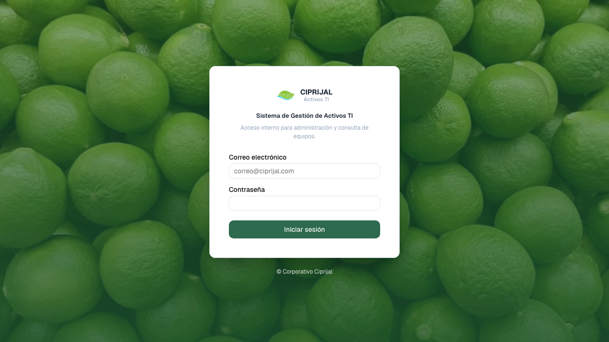

---

## 2. Perfil Administrador TI

El Administrador TI dispone de funciones para gestionar usuarios, ubicaciones, tipos de activo,
activos, asignaciones, devoluciones, incidencias, mantenimiento, gastos, reportes e información
técnica.

### 2.1 Dashboard

El panel principal muestra indicadores generales del inventario (total de activos, equipos en
almacén, equipos asignados, incidencias activas y mantenimientos activos) y una sección de alertas
operativas con acceso directo a los registros pendientes.

**Figura 2.** Panel principal (dashboard) del Administrador TI.
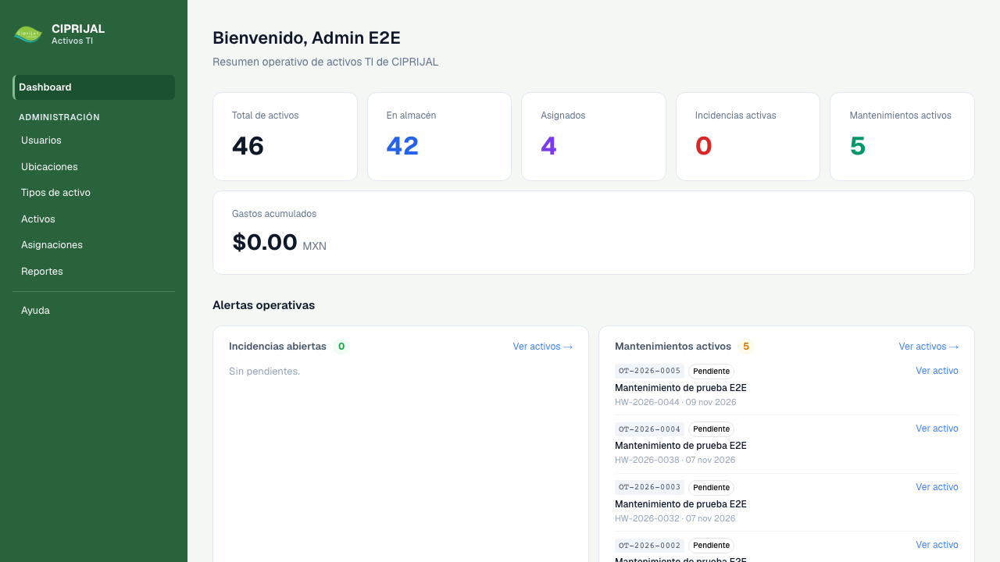

### 2.2 Ubicaciones y tipos de activo

El administrador puede crear y mantener los catálogos utilizados por el inventario.

- **Ubicaciones:** identifican la sede o localidad donde se encuentra un activo o usuario.
- **Tipos de activo:** permiten clasificar equipos como computadoras, monitores, dispositivos de
  red u otras categorías requeridas por la empresa.

Para crear una ubicación: entrar a **Ubicaciones → Nueva ubicación**, capturar el nombre y, de
forma opcional, una descripción, y seleccionar **Crear ubicación**. El alta de un tipo de activo
sigue el mismo patrón desde **Tipos de activo → Nuevo tipo**.

**Figura 3.** Alta de una nueva ubicación.
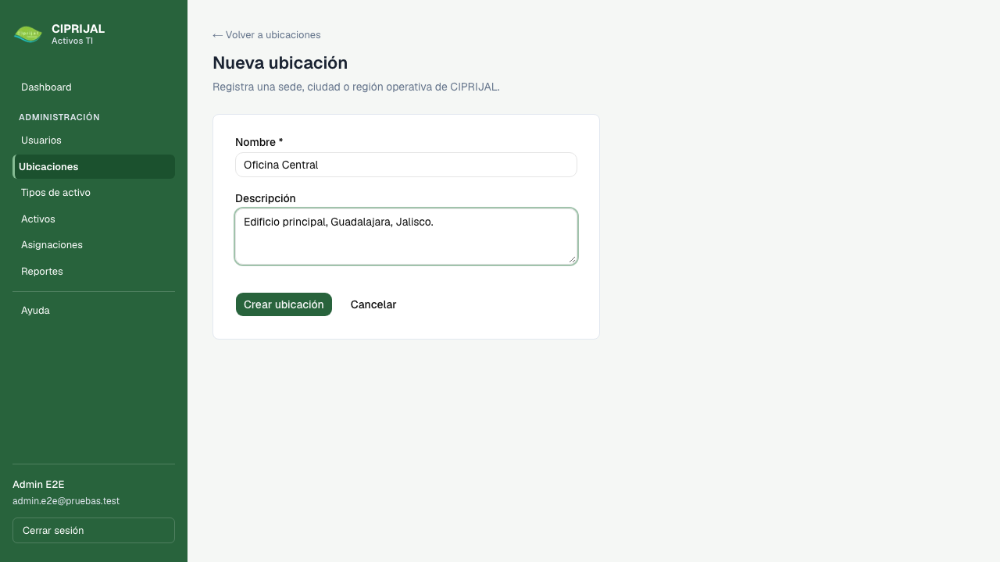

**Figura 4.** Listado de ubicaciones registradas.
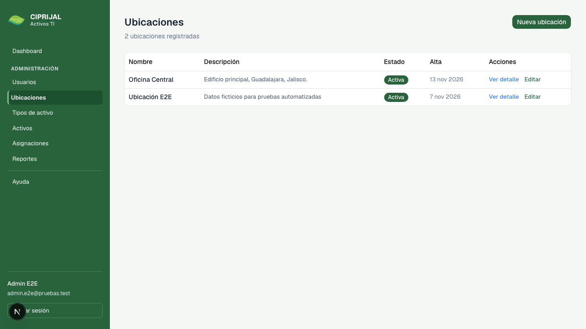

**Figura 5.** Listado de tipos de activo registrados.
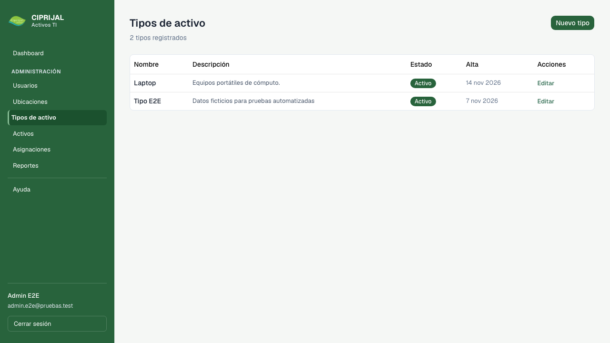

### 2.3 Gestión de usuarios

Para crear un usuario:

1. Entrar al módulo **Usuarios**.
2. Seleccionar **Nuevo usuario**.
3. Capturar nombre, apellido y correo electrónico.
4. Elegir el rol correspondiente: **Administrador TI** o **Usuario Final**.
5. Capturar, cuando aplique, puesto, teléfono, modalidad y ubicación. El teléfono es opcional; si
   se captura, debe tener exactamente 10 dígitos numéricos — el propio formulario del navegador
   impide guardar un teléfono con un formato distinto.
6. Definir una contraseña inicial.
7. Seleccionar **Crear usuario**.

**Figura 6.** Alta de un nuevo usuario.
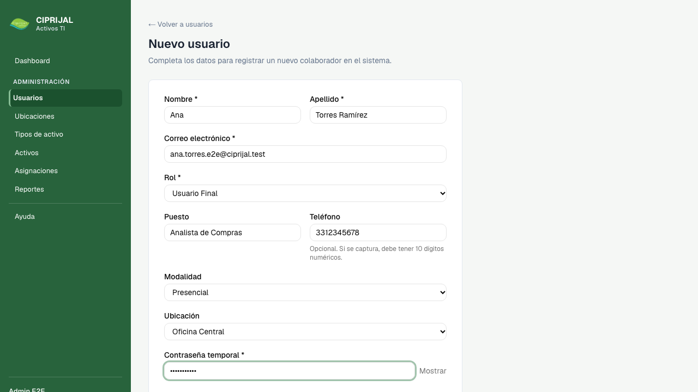

**Figura 7.** Listado de usuarios registrados.
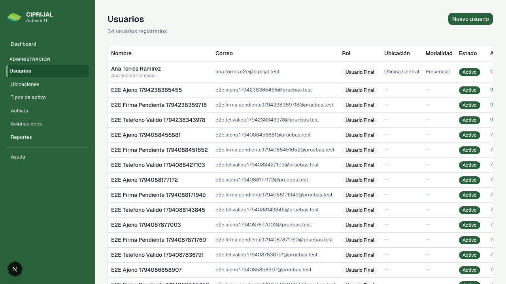

El sistema permite también editar la información de un usuario, restablecer su contraseña, y
activarlo o desactivarlo. Son importantes las siguientes reglas:

- **El correo electrónico no puede modificarse** una vez que el usuario fue dado de alta. El campo
  aparece bloqueado en la pantalla de edición; si el correo de alguien cambia, debe darse de baja
  esa cuenta y crear una nueva con el correo correcto.
- **El sistema no envía correos electrónicos de ningún tipo** (ni de bienvenida, ni de
  recuperación de contraseña, ni notificaciones). Al crear un usuario o restablecer su contraseña,
  el Administrador TI debe **entregar la contraseña inicial directamente al usuario, por un medio
  seguro** (en persona, por una llamada, etc.) — nunca por un canal que pueda quedar expuesto.
- **El sistema no obliga a cambiar la contraseña inicial**, y **el propio usuario no tiene forma de
  cambiarla por sí mismo** desde ningún lugar del sistema. La única manera de establecer una nueva
  contraseña para un usuario es que el **Administrador TI la restablezca** desde la pantalla de
  edición de ese usuario.
- No es posible desactivar a un usuario mientras tenga un equipo asignado activo o una devolución
  pendiente de su firma; el sistema debe resolver primero esas pendientes.

**Figura 8.** Pantalla de edición de un usuario, mostrando la sección para desactivarlo.
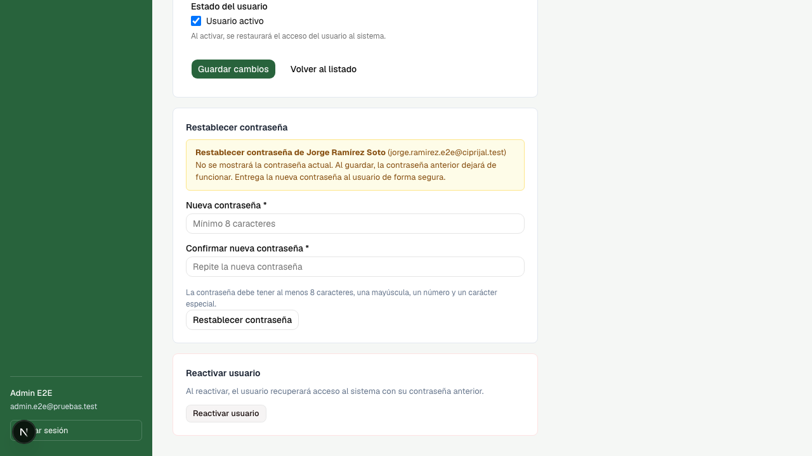

**Figura 9.** La misma pantalla después de reactivar al usuario: el acceso se restaura de
inmediato con la misma contraseña que tenía antes de ser desactivado.
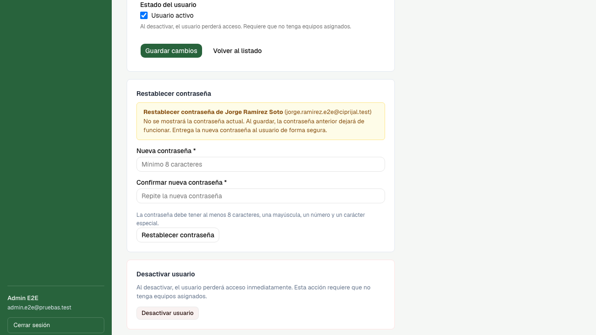

### 2.4 Registro de activos

Para registrar un activo:

1. Entrar al módulo **Activos**.
2. Seleccionar **Nuevo activo**.
3. Capturar los datos obligatorios (nombre, número de serie, tipo de activo, ubicación) y los
   complementarios disponibles (marca, modelo, número de parte, identificadores internos, fecha y
   precio de compra, notas).
4. Guardar el registro.

Un activo recién creado siempre inicia en estado **En almacén**.

**Figura 10.** Alta de un nuevo activo.
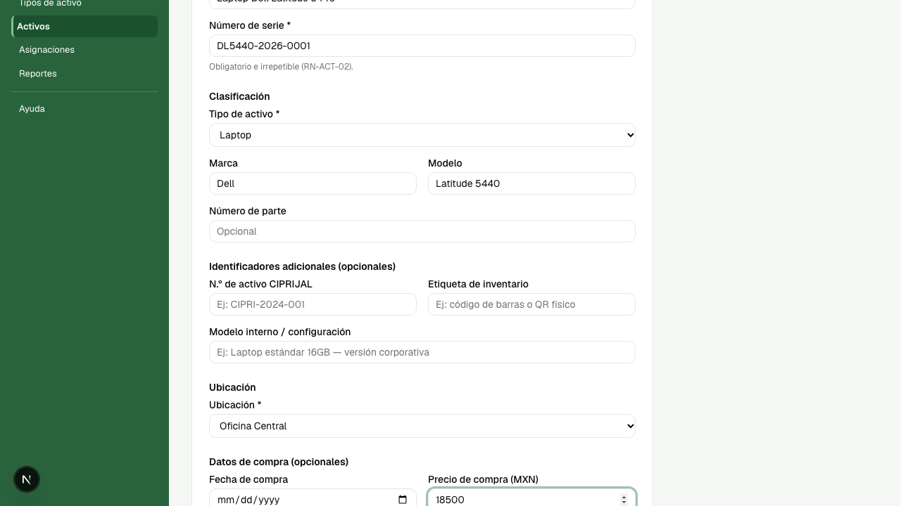

**Figura 11.** Listado de activos, con sus filtros de búsqueda (nombre/serie/código, estado, tipo,
ubicación, asignación e incidencias/mantenimiento).
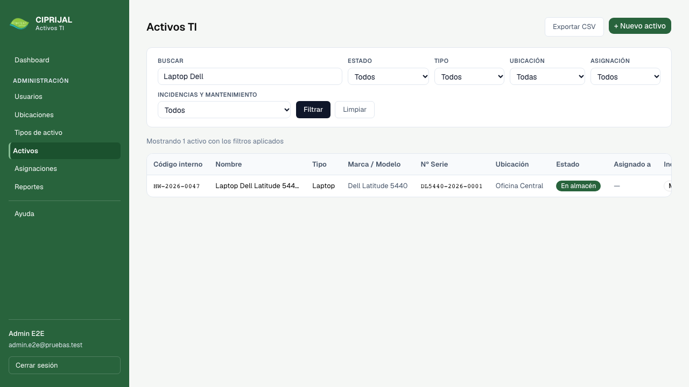

### 2.5 Consulta y edición de activos

Desde el listado de activos, el enlace **Ver** de cada fila abre el detalle del equipo, donde se
concentra: información general, asignación actual, historial de asignaciones, incidencias,
mantenimiento, gastos, información técnica y credenciales (cuando el rol lo permite).

**Figura 12.** Detalle de un activo, con su asignación actual.
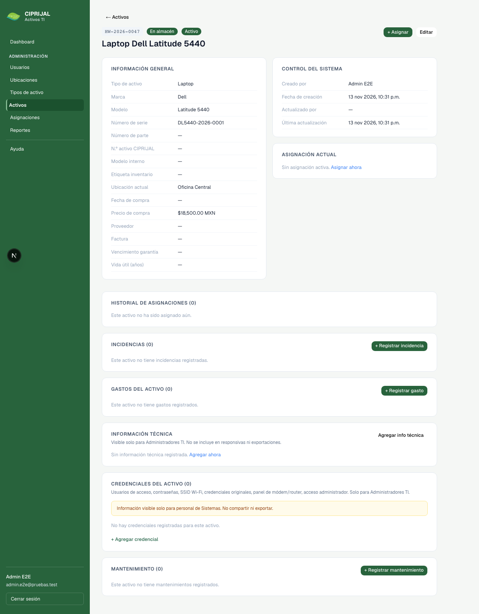

Desde la edición del activo se puede cambiar su **estado operativo**. La lista desplegable solo
permite elegir entre **cuatro** estados: *En almacén*, *Asignado*, *En mantenimiento* y *Dado de
baja*. (El sistema también contempla internamente los estados *Robado* y *Perdido*, reservados en
el modelo de datos para una ampliación futura, pero **el formulario no permite seleccionarlos** —
no es posible marcar un activo como robado o perdido desde esta pantalla.)

**Figura 13.** Formulario de edición de un activo, mostrando el campo "Estado operativo" con sus
cuatro opciones disponibles.
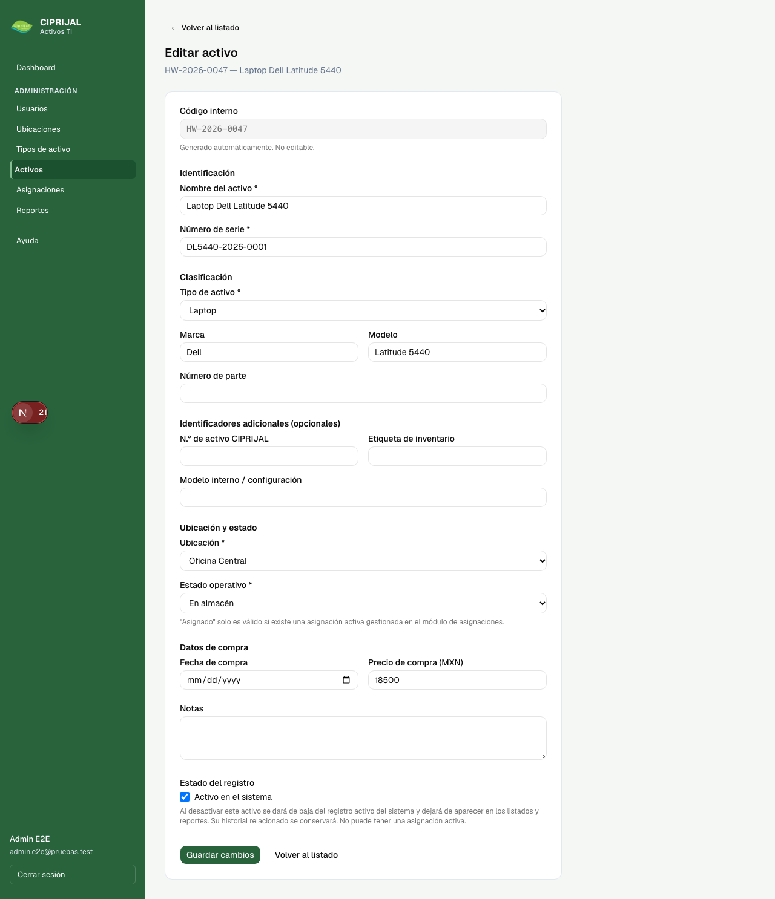

### 2.6 Baja de un activo

Cuando un equipo deja de utilizarse de forma definitiva, puede marcarse como dado de baja desde la
edición del activo. No es posible dar de baja un activo que tiene una asignación activa (primero
debe registrarse la devolución) ni uno que tiene una orden de mantenimiento abierta (primero debe
cerrarse el mantenimiento).

### 2.7 Asignación de equipos

Para asignar un activo a un usuario:

1. Entrar al módulo **Asignaciones**.
2. Seleccionar **Nueva asignación**.
3. Elegir un activo disponible. Los activos con una orden de mantenimiento abierta no aparecen en
   esta lista; debe cerrarse el mantenimiento antes de poder asignarlos.
4. Seleccionar al usuario que recibirá el equipo.
5. La fecha de asignación siempre es la fecha del día en que se realiza el registro.
6. Capturar ubicación de entrega, accesorios y notas, cuando corresponda.
7. Seleccionar **Crear asignación**.

**Figura 14.** Formulario de nueva asignación.
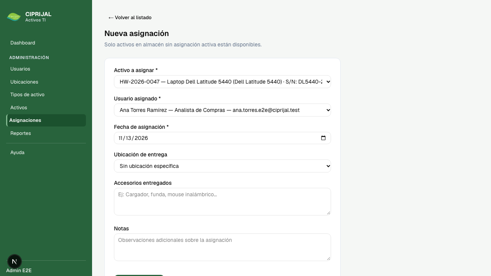

**Figura 15.** Listado de asignaciones.
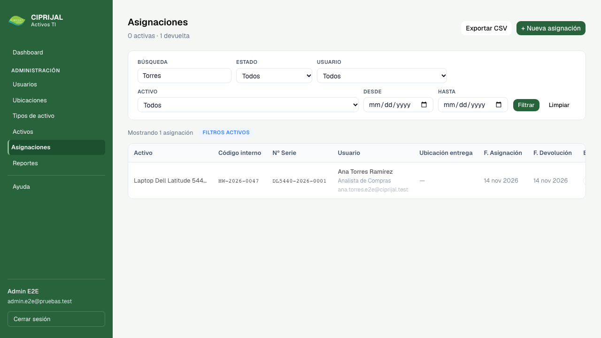

Al finalizar, el sistema actualiza el estado del activo y conserva el registro histórico de la
asignación. La asignación queda pendiente de firma de recepción hasta que el propio Usuario Final
la firme desde su portal (ver `MANUAL_USUARIO_FINAL.md`).

Un equipo también puede asignarse a un Administrador TI. En ese caso, mientras tenga una asignación
propia pendiente de firma de recepción o de devolución, el Administrador TI verá aparecer **Mis
activos** en su propio menú, además de sus opciones habituales, para poder firmar igual que lo
haría un Usuario Final (ver sección 2.19).

### 2.8 Responsiva de entrega

Después de una asignación se puede consultar la responsiva correspondiente, con los datos
principales del activo, usuario, responsable de TI, fecha, accesorios, notas y la firma registrada
(o la indicación de que todavía está pendiente).

**Figura 16.** Responsiva de entrega, antes de que el usuario firme su recepción.
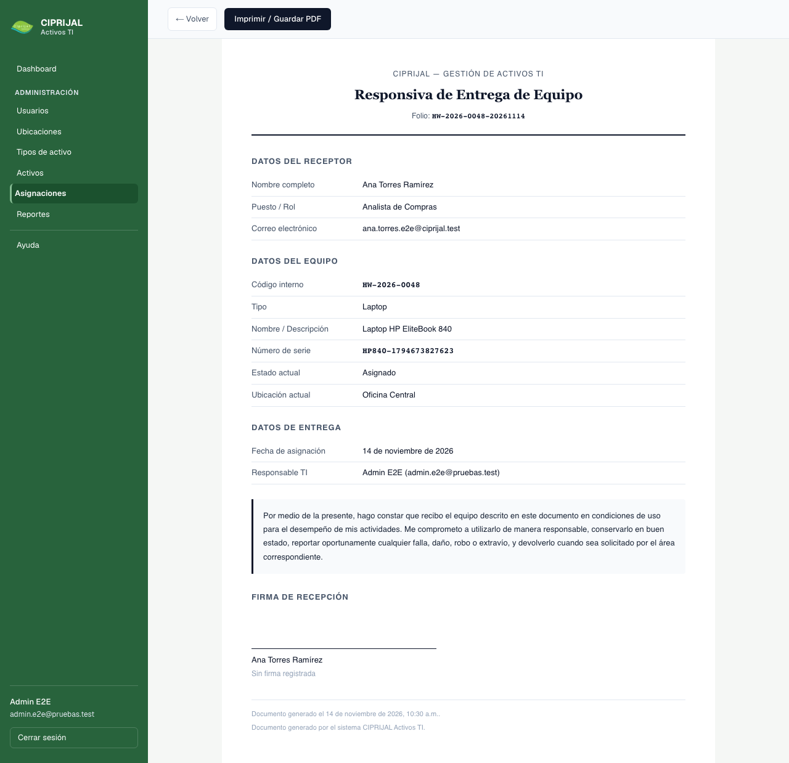

### 2.9 Incidencias

El módulo de incidencias permite registrar y dar seguimiento a fallas relacionadas con un activo.
Pueden reportarse tanto por el Administrador TI (desde el detalle del activo, botón **+ Registrar
incidencia**) como por el propio Usuario Final afectado (ver `MANUAL_USUARIO_FINAL.md`).

**Figura 17.** Detalle de un activo con dos incidencias reportadas.
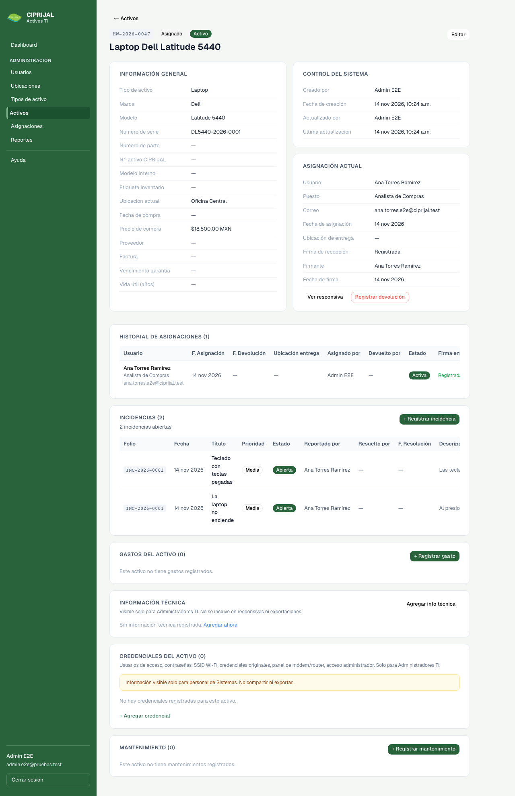

Al actualizar una incidencia (enlace **Actualizar** en su fila), el administrador solo puede
cambiar su **estado**, su **fecha de resolución** y su **resolución** — la prioridad capturada al
reportarla no se puede modificar desde esta pantalla, solo se muestra como referencia. Es
importante distinguir entre los dos estados de cierre disponibles:

- **Resuelta:** indica que el problema ya se solucionó, pero **la incidencia sigue pudiendo
  editarse** más adelante (por ejemplo, para corregir la descripción de la resolución).
- **Cerrada:** es el cierre definitivo. **Una vez cerrada, la incidencia ya no puede modificarse en
  absoluto** — el sistema retira por completo el enlace para actualizarla de esa fila; no vuelve a
  ofrecerse la opción de editarla.

**Ambos estados exigen capturar el texto de la resolución** antes de poder guardar el cambio; el
sistema rechaza guardar una incidencia como Resuelta o Cerrada sin ese dato.

**Figura 18.** Marcando una incidencia como "Resuelta", con su resolución capturada.
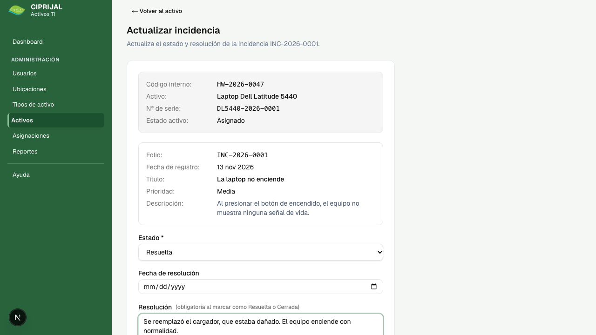

**Figura 19.** El mismo activo con una incidencia en estado "Resuelta" y otra en estado "Cerrada".
Nótese que la incidencia cerrada ya no conserva el enlace para actualizarla.
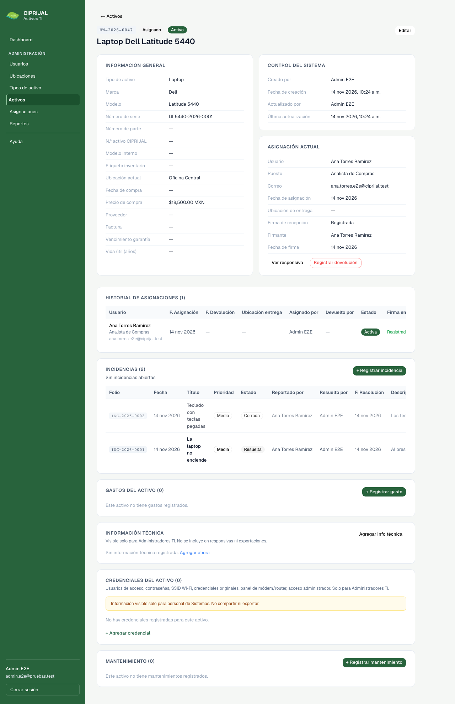

### 2.10 Mantenimiento

En el detalle de un activo se pueden registrar órdenes de mantenimiento preventivo, correctivo o
relacionadas con garantía (botón **+ Registrar mantenimiento**). Las órdenes permiten conservar
antecedentes de trabajos realizados, estado, fechas, resultado y costo cuando corresponda.
Mientras una orden de mantenimiento esté abierta, el activo no puede asignarse a ningún usuario
(ver sección 2.7).

**Importante:** crear o cerrar una orden de mantenimiento **no cambia automáticamente el estado
del activo**. Si, por ejemplo, un equipo entra a reparación, el Administrador TI debe cambiar su
estado operativo a *En mantenimiento* manualmente desde la edición del activo (sección 2.5); y al
terminar el trabajo, debe regresarlo manualmente a *En almacén* o al estado que corresponda.

**Figura 20.** Registro de una nueva orden de mantenimiento.
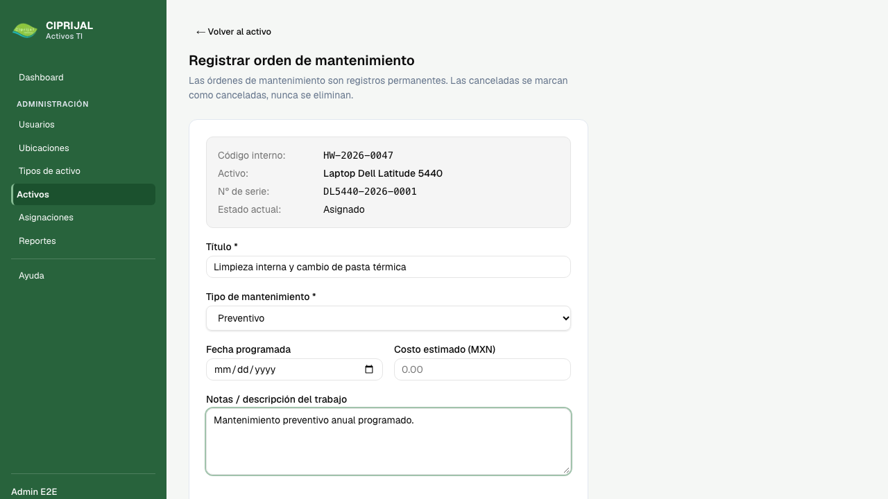

### 2.11 Gastos por activo

El administrador puede registrar gastos asociados a un activo (botón **+ Registrar gasto**), como
reparaciones, refacciones, accesorios u otros conceptos. Esta información forma parte del
historial del equipo y se refleja en los reportes.

**Figura 21.** Registro de un gasto asociado a un activo.
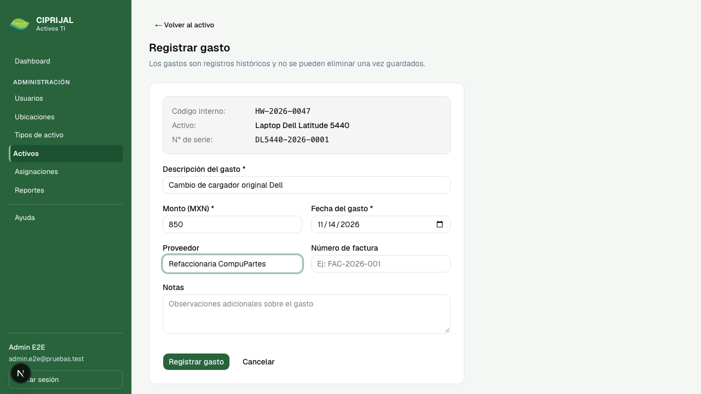

### 2.12 Información técnica del activo

Cuando se requiera, el Administrador TI puede registrar información técnica del equipo: hostname,
dirección IP (local y pública), direcciones MAC, sistema operativo, versión de Office, firmware,
número de modelo, número de orden, si el equipo es propiedad del empleado (BYOD), si está
disponible para préstamo, y notas técnicas. Esta sección es visible únicamente para Administradores
TI y nunca se incluye en responsivas ni exportaciones.

**Figura 22.** Formulario de información técnica de un activo.
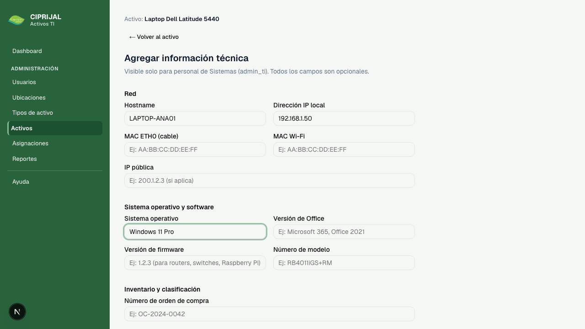

### 2.13 Credenciales del activo

Las credenciales asociadas a un equipo (por ejemplo, acceso a BIOS, red Wi-Fi, panel de
administración) se administran en una sección restringida al rol Administrador TI. Esta
información no se muestra al Usuario Final ni se incluye en reportes o responsivas destinados a
otros usuarios. El propio formulario advierte no compartir ni exportar esta información, y no
guardar en él contraseñas personales de empleados.

**Figura 23.** Alta de una credencial de acceso para un activo.
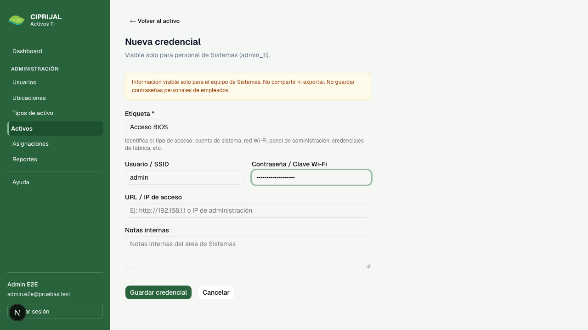

**Figura 24.** Vista completa del detalle de un activo, con todas sus secciones (asignación,
historial, incidencias, gastos, información técnica y credenciales).
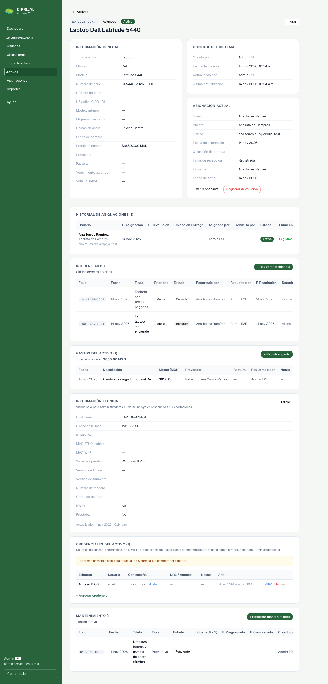

### 2.14 Devolución de equipos

Para registrar una devolución:

1. Localizar la asignación activa en el listado de **Asignaciones**.
2. Seleccionar la opción **Devolver**.
3. La fecha de devolución siempre es la fecha del día en que se realiza el registro.
4. Capturar la información solicitada.
5. Registrar la firma de devolución como responsable de Sistemas que recibe el equipo.
6. Seleccionar **Confirmar devolución**.

**Figura 25.** Registro de una devolución, con la firma de quien recibe el equipo (Sistemas) ya
capturada.
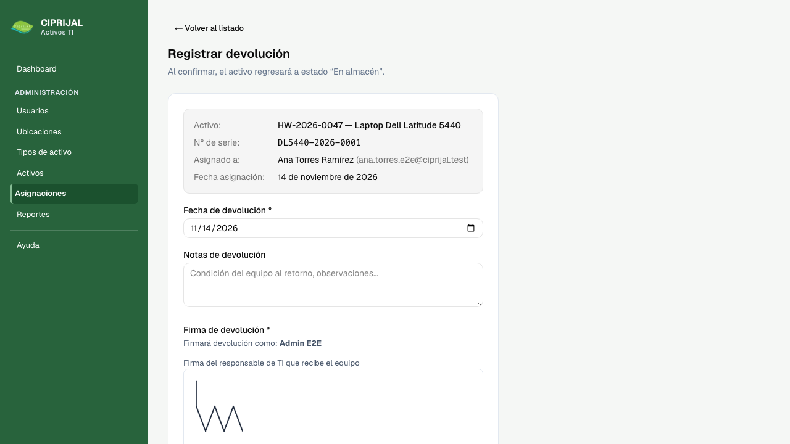

Al completar el proceso, la asignación queda cerrada y el activo vuelve a quedar disponible. La
devolución queda pendiente de la firma de quien entrega el equipo (el Usuario Final), quien debe
firmarla por separado desde su propio portal (ver `MANUAL_USUARIO_FINAL.md`).

### 2.15 Responsiva de devolución

El sistema genera una responsiva de devolución con los datos del movimiento, fecha, activo y
usuario. La responsiva muestra por separado la firma de quien entrega el equipo (Usuario Final) y
la firma de quien lo recibe (Administrador TI).

**Figura 26.** Responsiva de devolución mientras la firma del usuario que entrega el equipo
todavía está pendiente.
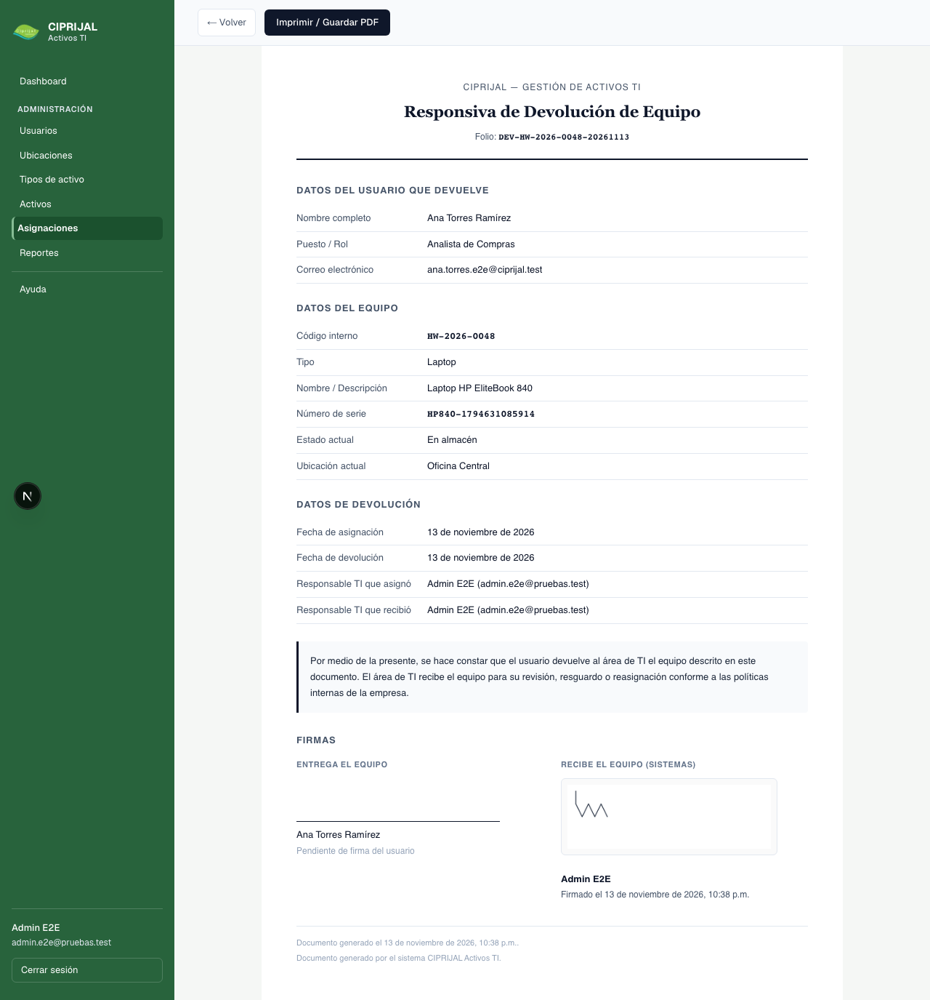

**Figura 27.** Responsiva de devolución una vez que ambas firmas (quien entrega y quien recibe) ya
están registradas.
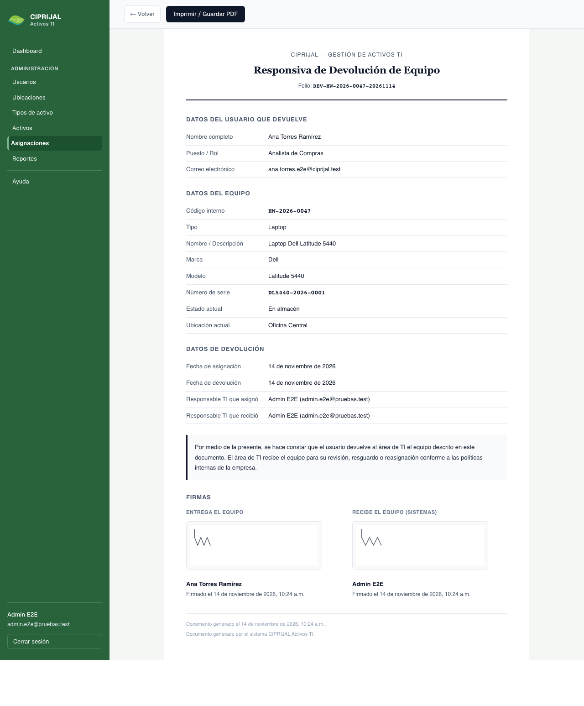

### 2.16 Detalle por ubicación

El administrador puede consultar una ubicación específica (enlace **Ver detalle** en el listado de
ubicaciones) para revisar los usuarios, activos, incidencias y mantenimientos relacionados con esa
localidad.

**Figura 28.** Detalle de una ubicación.

### 2.17 Reportes y exportaciones

El módulo de reportes permite consultar información consolidada del inventario: distribución de
activos por estado, tipo y ubicación, gastos acumulados, incidencias abiertas recientes y órdenes
de mantenimiento activas. Los listados de activos y asignaciones también pueden exportarse en
formato CSV respetando los filtros aplicados.

**Figura 29.** Pantalla de reportes.
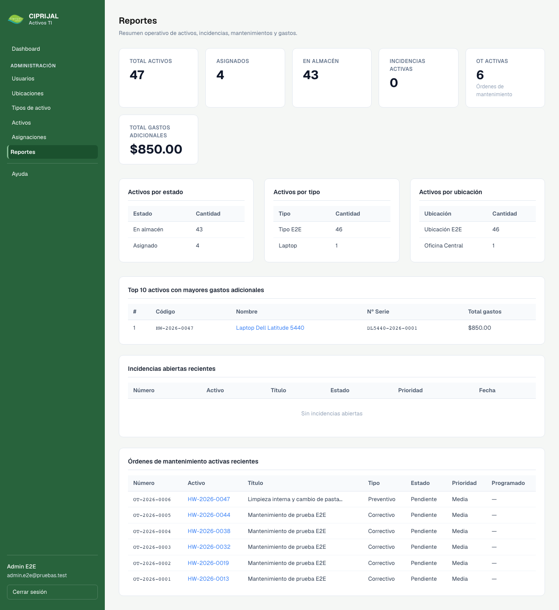

### 2.18 Ayuda

El sistema incluye una guía rápida interna, disponible en el menú lateral bajo **Ayuda**, con el
flujo principal de un activo paso a paso, las tareas de operación diaria, un resumen del portal del
Usuario Final, los roles del sistema y una lista de buenas prácticas. Es un atajo de consulta
rápida dentro del propio sistema, complementario a este manual.

**Figura 30.** Pantalla de ayuda / guía rápida del sistema.
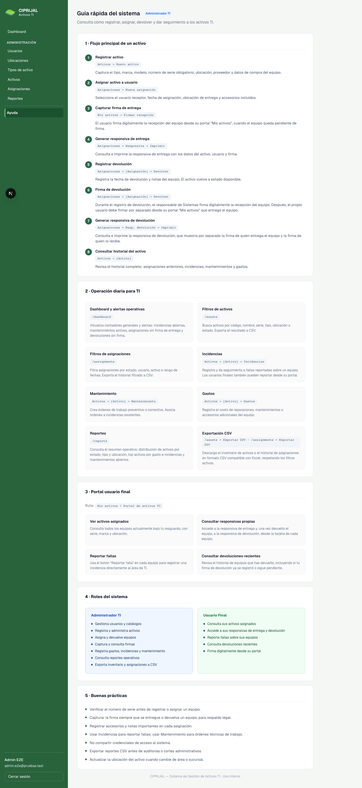

### 2.19 Cuando al Administrador TI se le asigna un equipo

El sistema no distingue por rol al seleccionar quién recibe una asignación (regla de negocio
RN-ASGN-13): un Administrador TI puede recibir un equipo igual que un Usuario Final. En ese caso,
el Administrador TI debe firmar su propia recepción y, si aplica, su propia devolución desde el
portal `/my-assets`, igual que cualquier otro usuario; esa ruta no está restringida por rol y no
expone datos de otros usuarios.

Mientras el Administrador TI tenga una asignación activa propia o una devolución con su firma
pendiente, el enlace **Mis activos** aparece también en su menú, además de sus opciones habituales
de administración, para que pueda llegar a firmar; si no tiene nada pendiente, el enlace no se
muestra.

**Figura 31.** Portal "Mis activos" con un equipo pendiente de firma de recepción (la pantalla es
la misma para un Administrador TI que tenga un equipo asignado).
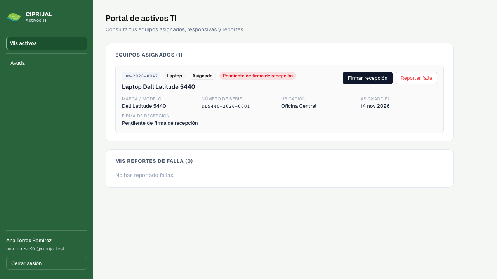

**Figura 32.** Pantalla de firma de recepción, con la firma ya dibujada — el procedimiento es
idéntico al que sigue un Usuario Final.
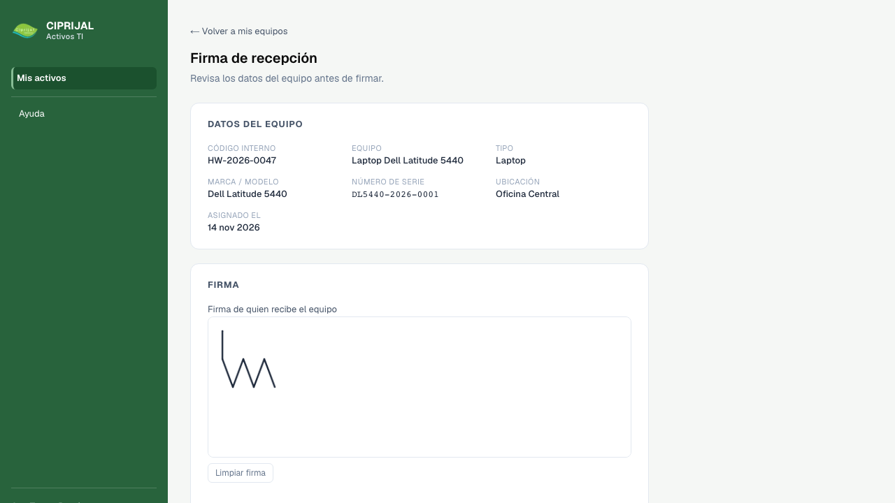

---

## 3. Cierre de sesión

Al finalizar el uso del sistema, se recomienda cerrar la sesión desde la opción correspondiente del
menú de usuario, especialmente cuando se utilice un equipo compartido.

**Figura 33.** Pantalla de inicio de sesión, tras cerrar sesión correctamente.

Además, **la sesión tiene una duración máxima de 30 minutos**; cuando expira, el sistema pide
iniciar sesión de nuevo.

El sistema también puede cerrar la sesión de forma automática si la cuenta del usuario es
desactivada o si su rol es modificado mientras la sesión sigue abierta. En ese caso, se mostrará el
mensaje "Tu sesión ya no es válida. Por favor, inicia sesión de nuevo." y será necesario volver a
iniciar sesión.

---

## 4. Consideraciones de seguridad

- No compartir contraseñas personales.
- No almacenar credenciales reales en documentos públicos o capturas de pantalla.
- Utilizar cuentas de demostración exclusivamente para evaluación o pruebas.
- Las funciones administrativas deben utilizarse únicamente por personal autorizado.
- La información de credenciales técnicas de activos está restringida al rol Administrador TI.
- El sistema **no envía correos electrónicos**: toda entrega de contraseña inicial (alta de
  usuario o restablecimiento) debe hacerse directamente, por un medio seguro, nunca por escrito en
  un canal que pueda quedar expuesto.
- El correo electrónico de un usuario **no puede modificarse** una vez creada la cuenta.

---

## 5. Soporte

En caso de dudas operativas, errores de acceso o problemas con los datos registrados, el usuario
debe contactar al personal responsable del área de Soporte TI.
