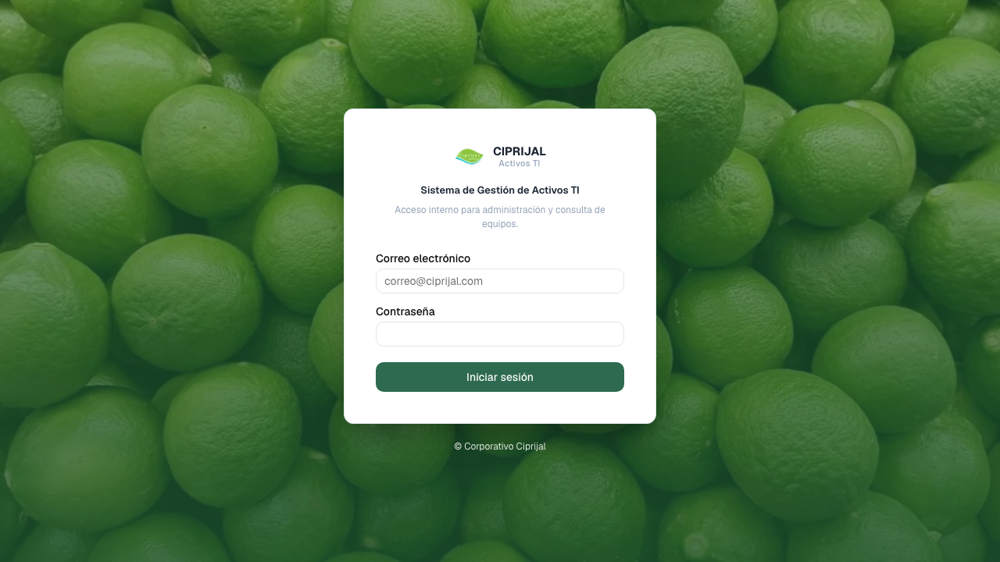
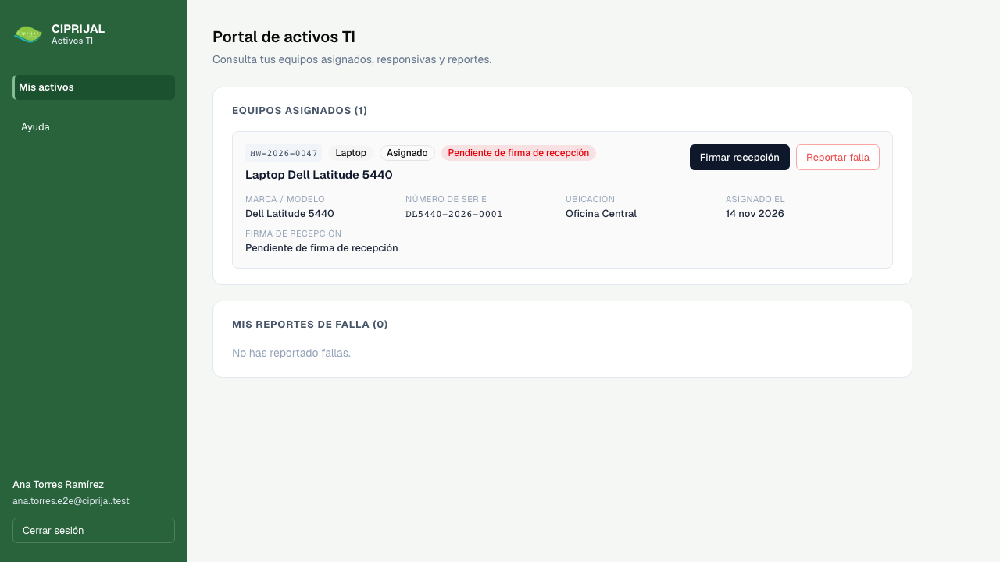
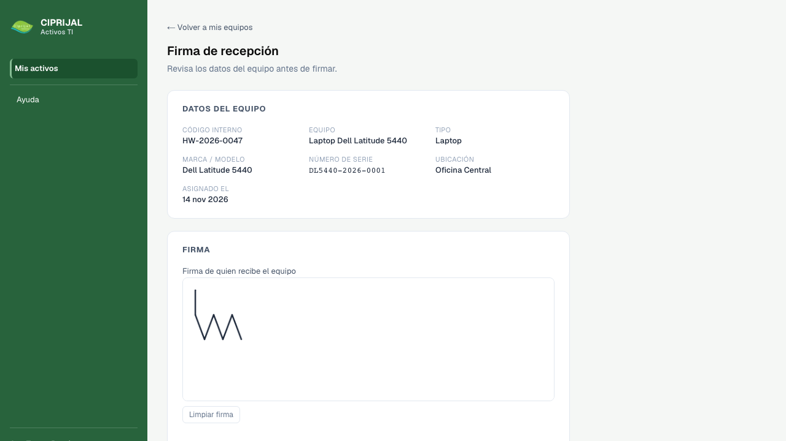
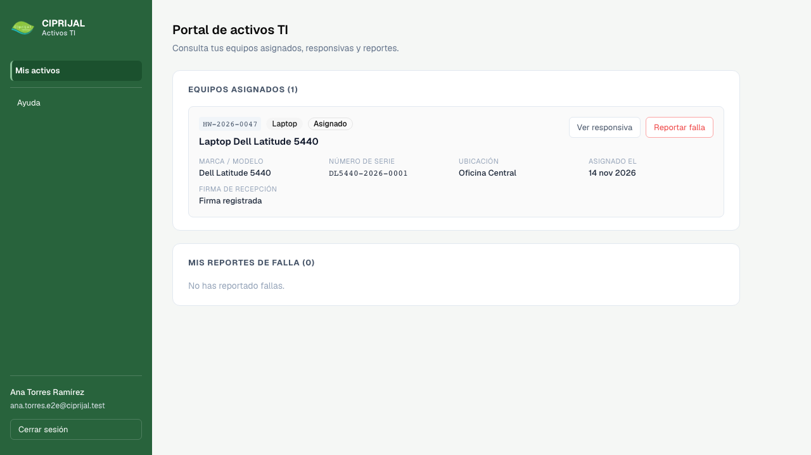
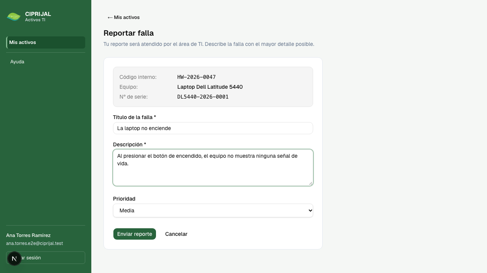
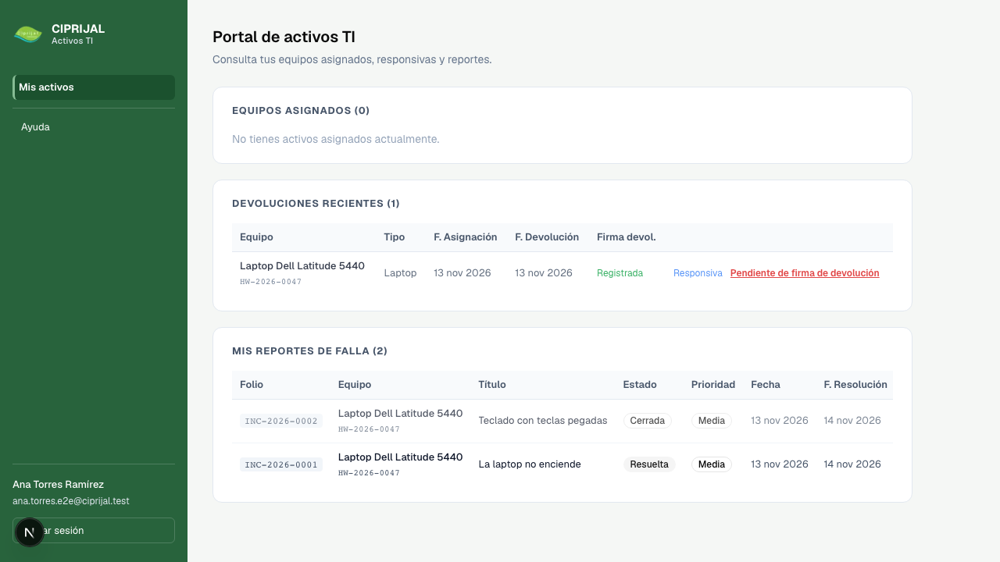
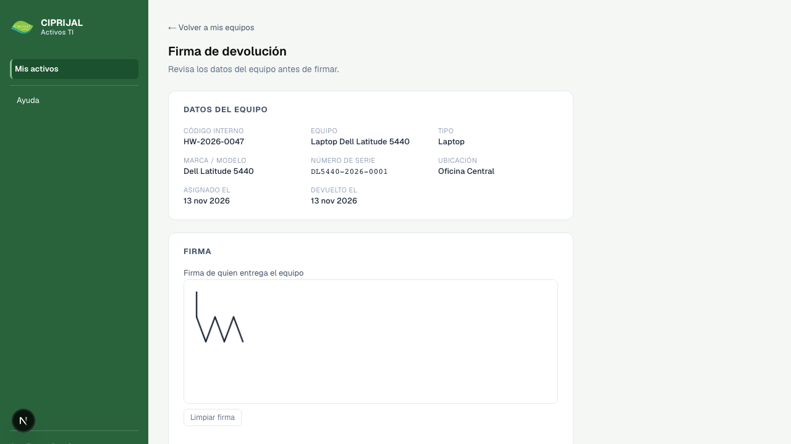

# Manual del Usuario Final

## Sistema de Gestión de Activos TI — CIPRIJAL

**Versión:** 1.0
**Fecha:** 2026-11-19

> **Nota sobre las capturas de pantalla.** Todas las imágenes de este manual se generaron en un
> entorno de pruebas aislado (base de datos `ciprijal_activos_e2e`, independiente de la base real
> del sistema), con usuarios, equipos y datos **completamente ficticios** creados únicamente para
> ilustrar este documento. Ninguna captura contiene información real de la empresa, contraseñas
> reales ni datos de empleados reales.

Este manual describe el uso del sistema de gestión de activos TI para el perfil **Usuario Final**.
El sistema cuenta con dos perfiles de acceso: Administrador TI y Usuario Final; este documento
cubre únicamente el segundo. Para el perfil Administrador TI, consultar
`MANUAL_ADMINISTRADOR.md`.

---

## 1. Inicio de sesión

1. Abrir la aplicación en el navegador.
2. Capturar el correo electrónico asignado.
3. Capturar la contraseña correspondiente.
4. Seleccionar **Iniciar sesión**.

El sistema valida que la cuenta esté activa y que las credenciales sean correctas. Después del
acceso, el **Usuario Final** entra a **Mis activos**.

Por seguridad, **tras 5 intentos fallidos la cuenta queda bloqueada durante 15 minutos**. Mientras
dure el bloqueo, el sistema muestra el mismo mensaje genérico de error ("Correo o contraseña
incorrectos.") que se muestra ante una contraseña incorrecta — no distingue si la cuenta está
bloqueada o si simplemente la contraseña es errónea.

**Figura 1.** Pantalla de inicio de sesión.

---

## 2. Perfil Usuario Final

El Usuario Final dispone de un portal restringido para consultar únicamente la información
relacionada con sus propios equipos y movimientos.

### 2.1 Mis activos

Desde **Mis activos**, el Usuario Final puede consultar los equipos que tiene asignados y acceder
a la información permitida de cada uno.

Cuando un equipo recién asignado está pendiente de firma, el sistema lo señala con la indicación
"Pendiente de firma de recepción" y permite firmarla seleccionando **Firmar recepción**.

**Figura 2.** Portal "Mis activos" con un equipo pendiente de firma de recepción.

### 2.2 Firmar la recepción de un equipo

Al seleccionar **Firmar recepción**, se abre una pantalla donde el usuario dibuja su firma sobre un
recuadro, con el mouse o el dedo (en pantallas táctiles), y confirma con el botón **Firmar
recepción**.

**Figura 3.** Pantalla de firma de recepción, con la firma ya dibujada.

Una vez firmada, el equipo deja de mostrarse como pendiente en el portal.

**Figura 4.** Portal "Mis activos" después de firmar la recepción: el equipo ya no muestra ninguna
firma pendiente.

### 2.3 Reportar una falla

Para reportar una incidencia sobre un equipo propio:

1. Entrar a **Mis activos**.
2. Seleccionar **Reportar falla** en el equipo correspondiente.
3. Capturar el título y la descripción del problema.
4. Elegir la prioridad del reporte (Baja, Media, Alta o Crítica). Si no se elige ninguna, el
   sistema la deja en **Media** por defecto.
5. Enviar el reporte.

La incidencia queda registrada para seguimiento por parte del personal de TI.

**Figura 5.** Formulario para reportar una falla desde el portal del Usuario Final.

### 2.4 Responsivas y devoluciones recientes

Desde **Mis activos**, el Usuario Final también puede consultar las responsivas correspondientes a
sus asignaciones y devoluciones, así como el historial de equipos que ya devolvió, indicando si su
firma de devolución ya se registró o si todavía está pendiente.

**Figura 6.** Portal "Mis activos" mostrando una devolución reciente pendiente de la firma del
usuario.

### 2.5 Firmar la devolución de un equipo

Cuando el Administrador TI ya registró la devolución de un equipo, el Usuario Final debe firmar
por separado, desde su propio portal, que efectivamente entregó el equipo. Al seleccionar la
indicación "Pendiente de firma de devolución" se abre la pantalla correspondiente, donde se dibuja
la firma de la misma manera que en la recepción.

**Figura 7.** Pantalla de firma de devolución, con la firma ya dibujada.

---

## 3. Cierre de sesión

Al finalizar el uso del sistema, se recomienda cerrar la sesión desde la opción correspondiente del
menú de usuario, especialmente cuando se utilice un equipo compartido.

**Figura 8.** Pantalla de inicio de sesión, tras cerrar sesión correctamente.

Además, **la sesión tiene una duración máxima de 30 minutos**; cuando expira, el sistema pide
iniciar sesión de nuevo.

El sistema también puede cerrar la sesión de forma automática si la cuenta del usuario es
desactivada o si su rol es modificado mientras la sesión sigue abierta. En ese caso, se mostrará el
mensaje "Tu sesión ya no es válida. Por favor, inicia sesión de nuevo." y será necesario volver a
iniciar sesión.

---

## 4. Consideraciones de seguridad

- No compartir contraseñas personales.
- No almacenar credenciales reales en documentos públicos o capturas de pantalla.
- Utilizar cuentas de demostración exclusivamente para evaluación o pruebas.
- El correo electrónico de un usuario **no puede modificarse** una vez creada la cuenta.
- **El Usuario Final no tiene forma de cambiar su propia contraseña** desde ningún lugar del
  sistema. Si la olvida o necesita una nueva, debe solicitarla al personal de Sistemas/Soporte TI,
  que es quien la restablece desde la pantalla de edición de ese usuario.

---

## 5. Soporte

En caso de dudas operativas, errores de acceso o problemas con los datos registrados, el usuario
debe contactar al personal responsable del área de Soporte TI.
